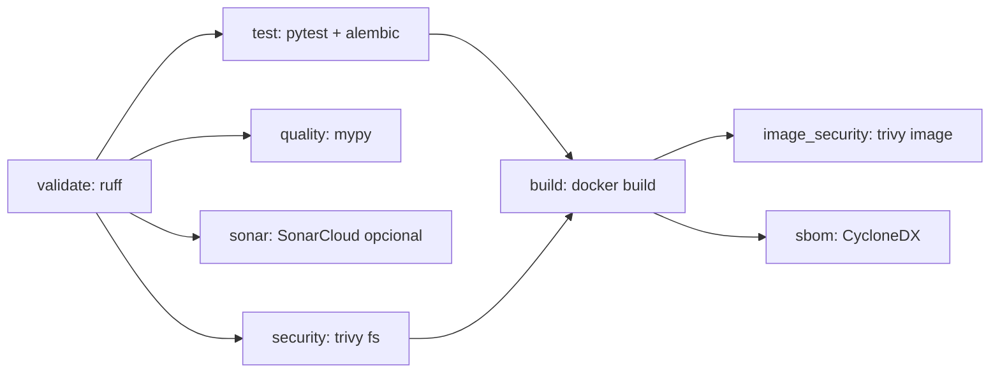

# Design Document

## Overview

Un único workflow `.github/workflows/ci.yml` con jobs por etapa, en el mismo orden que la librería de templates personal. Se prefiere ejecutar herramientas por línea de comandos (`uv`, imagen `aquasec/trivy`) en lugar de actions de terceros, para reducir superficie de cadena de suministro y mantener paridad con GitLab.

## Arquitectura

## Jobs

| Job | Etapa | Contenido | Bloquea |
|-----|-------|-----------|---------|
| `validate` | validate | `ruff check`, `ruff format --check` | Sí |
| `test` | test | `pytest` con cobertura; `alembic upgrade head` sobre SQLite temporal | Sí |
| `quality` | quality | `mypy src` | Sí |
| `sonar` | quality | SonarCloud con `sonar.qualitygate.wait=true`; se omite si faltan `SONAR_TOKEN` (secret) o `SONAR_ORGANIZATION` y `SONAR_PROJECT_KEY` (variables del repositorio) | Sí, si está configurado |
| `security` | security | `trivy fs` con `vuln,secret,misconfig`; bloquea `CRITICAL` | Sí |
| `build` | build | `docker build` local, imagen cargada como artefacto | Sí |
| `image_security` | image_security | `trivy image` sobre la imagen construida | Sí (`CRITICAL`) |
| `sbom` | sbom | `trivy fs --format cyclonedx` | No |

## Decisiones

- Trivy se ejecuta con la imagen `aquasec/trivy:0.76.2`. La versión `0.58.1` de la librería de templates no puede interpretar el paquete de checks Rego que descarga hoy (errores `rego_type_error` y checks omitidos), por lo que se usa una versión reciente; la librería de templates debería actualizarse igual.
- Concurrencia: se cancela la ejecución previa de la misma rama (`cancel-in-progress`).
- `GIT_DEPTH` completo solo se solicita en el job opcional de Sonar.
- SonarCloud: la organización y la clave del proyecto se leen de variables del repositorio, nunca del código. Los pull requests desde forks no reciben secretos, por lo que el job se omite. La cobertura se genera con `pytest-cov` (`coverage.xml`, rutas relativas por `relative_files = true`) en el job `test` y se entrega al job `sonar` como artefacto; por eso `sonar` depende de `test`.
- Dependabot (`.github/dependabot.yml`) cubre `pip`/`uv`, `docker` y `github-actions`.
- Las actions de GitHub (`actions/*`) se fijan por versión mayor. Las de terceros (`astral-sh/setup-uv`, `SonarSource/sonarqube-scan-action`) se fijan por SHA completo (regla Sonar `githubactions:S7637`); Dependabot las actualiza.
- `SonarSource/sonarqube-scan-action` usa la versión `v6.0.0`, que reemplaza la implementación Bash por JavaScript y cambia el análisis de `args`: cada argumento que contenga espacios debe pasar como una cadena entrecomillada. Los argumentos actuales (`organization`, `projectKey`, versión de Python, cobertura y Quality Gate) no contienen espacios y no requieren `projectBaseDir`.
- `uv` se invoca con `--frozen --no-build` (reglas Sonar `githubactions:S8544` y `S8541`): no se resuelven versiones fuera de `uv.lock` ni se construyen distribuciones fuente de dependencias; solo se construye el proyecto local.

## Riesgos

- Un hallazgo `CRITICAL` nuevo en la imagen base puede romper el pipeline sin cambios de código: mitigación con `.trivyignore` versionado y justificado.
- Los jobs no se validaron en un runner real de GitHub; solo se valida sintaxis YAML localmente.

## Testing

- Validación local de sintaxis YAML y de los comandos de calidad.
- La primera ejecución en GitHub es la evidencia definitiva.
