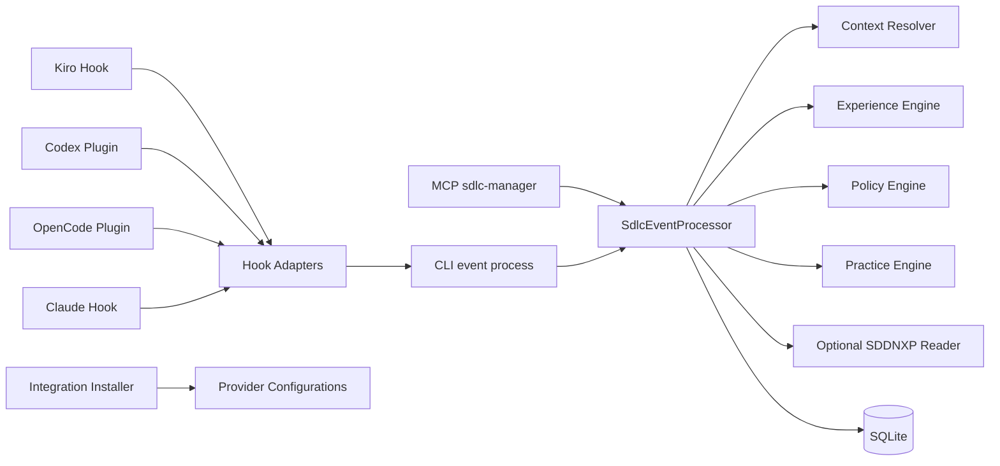

# Diseño De Engineering Companion Multiagente

## Overview

La solución conserva `SdlcEventProcessor` como núcleo y agrega tres superficies:

1. Resolución contextual de experiencias sin devolver la memoria completa.
2. Hooks y plugins delgados que hacen visible la respuesta del CLI.
3. Instalador con merge seguro, backups, idempotencia y desinstalación selectiva.

SDDNXP se consulta mediante un reader local opcional. No se ejecutan comandos ni
se modifican archivos de su governance.

## Architecture



Los adapters no importan SDKs de clientes. Utilizan stdin/stdout y archivos de
configuración propios. La salida del CLI permanece JSON y los adapters generan
una vista breve para el contexto visible.

## Components and Interfaces

### Context resolver

`src/sdlc_manager/application/services/context_resolver.py` infiere un
componente solamente cuando el evento lo declara o cuando la ruta relativa
permite identificar de forma segura el primer segmento relevante. No lee el
contenido de archivos.

### SDDNXP reader

`src/sdlc_manager/infrastructure/sddnxp/reader.py` lee `.sdd/config.yaml` y
metadatos `spec.yaml`. Devuelve un snapshot opcional; no valida ni modifica el
workflow externo.

### Hook runner

`integrations/common/hook_runner.py` recibe JSON, normaliza un evento y ejecuta
el comando configurado en `SDLC_MANAGER_COMMAND` sin shell. Produce JSON limpio
y una sección visible únicamente cuando existen recomendaciones, experiencias,
warnings, bloqueos o errores.

### Integration installer

`src/sdlc_manager/infrastructure/integrations/installer.py` opera por proyecto
por defecto y soporta alcance de usuario explícito. Usa recursos identificados
por namespace, backups locales, archivos temporales y merges conservadores.

### Provider surfaces

- Kiro: `.kiro/settings/mcp.json`, steering propio y hook `PostFileSave` no
  bloqueante.
- Claude Code: `.mcp.json`, `.claude/settings.local.json` y bloque de
  instrucciones propio.
- OpenCode: `opencode.json` JSON; si solo existe `opencode.jsonc`, el instalador
  no lo reescribe y reporta merge manual.
- Codex: paquete portable bajo `.sdlc-manager/providers/codex-plugin`; su
  activación requiere revisión y confianza del usuario según el runtime.

## Data Models

No se agrega una tabla para el instalador. El estado de integración vive en
`.sdlc-manager/integrations.json` y los backups en
`.sdlc-manager/backups/integrations/`.

El contrato de eventos existente permanece compatible. Se agrega contexto
opcional de SDDNXP al resultado sin cambiar decisiones ni estados existentes.

## API Contracts

CLI:

```text
sdlc-manager integrations list [--scope project|user]
sdlc-manager integrations plan [provider ...] [--scope project|user]
sdlc-manager integrations install [provider ...] [--scope project|user]
sdlc-manager integrations status [--scope project|user]
sdlc-manager integrations uninstall [provider ...] [--scope project|user]
```

Los comandos devuelven JSON con `status`, `provider`, `actions`, `backups`,
`warnings`, `conflicts` y `verification` cuando se usa `--json`.

## Error Handling

- Conflicto de archivo: no se escribe y se devuelve `CONFLICT`.
- JSON inválido: no se modifica el archivo.
- JSONC no editable de forma segura: `MANUAL_MERGE_REQUIRED`.
- Hook inválido: `INVALID_EVENT` y código 40.
- Error técnico del CLI: código 50 o 51 según `retryable`.

## Testing Strategy

- Unit tests para resolución contextual, normalización y merge seguro.
- Integración con filesystem temporal para cada proveedor.
- Pruebas de stdout visible y stderr separado.
- Pruebas de idempotencia, conflicto, backup y desinstalación.
- Pruebas con y sin `.sdd/config.yaml`.
- Validación sintáctica de JSON, TOML y manifiestos.
- Pruebas reales de cliente se clasifican por separado y no se declaran desde
  mocks.

## Decisiones Técnicas

1. **Proyecto por defecto:** evita modificar perfiles globales accidentalmente.
2. **JSONC no se reescribe:** conservar comentarios requiere un parser específico
   y no debe simularse con `json.loads`.
3. **Codex como paquete revisable:** el runtime exige revisión y confianza de
   hooks; el instalador no ejecuta un registro global silencioso.
4. **Reader SDDNXP local:** evita depender de Engram y evita duplicar su motor.
5. **Salida visible del hook:** persistir el evento no satisface el objetivo; el
   resultado debe llegar al contexto del agente.

## Riesgos e Incertidumbres

- Los payloads nativos pueden variar por versión.
- OpenCode V1 y V2 tienen APIs de plugins distintas.
- Codex puede requerir activación manual y confianza del usuario.
- SQLite puede bloquearse con muchos hooks concurrentes.
- Un proyecto sin `SDLC_MANAGER_PROJECT_ID` no puede evaluar gates que exigen
  UUID de proyecto.
