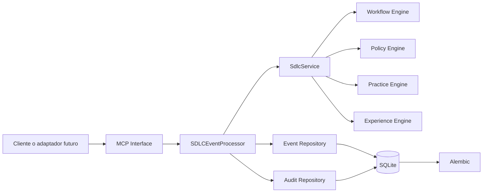

# Diseño De SDLC Event Processor

## Overview

Se agrega un servicio de aplicación independiente del cliente que valida eventos, coordina `SdlcService`, conserva idempotencia en SQLite y emite respuestas estructuradas. Los adaptadores futuros solo deberán convertir sus eventos al contrato `SdlcEvent`.

## Architecture

`SDLCEventProcessor` no conoce SDKs de clientes. `source_client` es metadata trazable y no se utiliza como identidad ni autorización.

## Components and Interfaces

### SdlcEvent

Archivo: `src/sdlc_manager/application/event_schemas.py`.

- `event_id`: `UuidInput`.
- `event_type`: `SdlcEventType` cerrado.
- `source_client`: texto acotado.
- `project_id` y `user_story_id`: UUID opcionales con validación por evento.
- `stage`: texto opcional acotado.
- `timestamp`: fecha con zona UTC.
- `affected_files`: lista acotada, sin rutas absolutas ni segmentos `..`.
- `context`: JSON acotado y sin ejecución.
- `schema_version`: `1.0`.

### SDLCEventProcessor

Archivo: `src/sdlc_manager/application/services/event_processor.py`.

Métodos principales:

- `process(event: SdlcEvent) -> EventProcessingResult`.
- `process_payload(payload: object) -> EventProcessingResult` para la frontera que necesita convertir errores de validación en respuestas estructuradas.

El servicio calcula una huella canónica SHA-256, consulta el repositorio de eventos antes de ejecutar efectos, delega en `SdlcService` y persiste el resultado junto con una entrada mínima de auditoría.

### Persistencia

Se agrega `ProcessedEvent`, `EventRepository` y `SqlAlchemyEventRepository`. La tabla física `TEVENTOSDLC` conserva `CEVENTO`, huella, estado, resultado JSON y fecha de creación. La huella evita aceptar la reutilización de un identificador con contenido diferente.

## Data Models

La migración `0004_event_processor` es aditiva: crea `TEVENTOSDLC` con llave primaria `CEVENTO` y agrega la columna opcional `CPROYECTO` a `TEXPERIENCIA` para filtrar memorias con alcance PROJECT. No elimina datos ni realiza backfill; las experiencias existentes conservan alcance y se mantienen visibles según las reglas de compatibilidad actuales.

## Event Processing

| Evento | Requisito | Acción |
| --- | --- | --- |
| `session_started` | Ninguno | Registra el evento; no ejecuta gate y devuelve decisión nula. |
| `sprint_started` | Proyecto | Ejecuta `start_sprint`; devuelve `WARN` si existen historias con riesgos, sin convertirlo en gate. |
| `user_story_started` | Proyecto y HU | Ejecuta `analyze_user_story`; devuelve `BLOCK` si la HU no está lista. |
| `sdd_task_started` | Proyecto y HU | Analiza la HU y, si `context.gate` existe, evalúa el gate. |
| `file_changed` | Proyecto | Ejecuta reglas, prácticas y búsqueda contextual; no evalúa un gate implícito. |
| `task_completed` | Proyecto y HU | Evalúa `context.gate` o `task_completion`. |
| `gate_evaluation_requested` | Proyecto y HU, `context.gate` | Evalúa el gate solicitado. |
| `incident_recorded` | Proyecto | Registra el evento y recupera experiencias filtradas si el contexto contiene consulta, componente o etiquetas. |

Los eventos sin gate retornan `decision: null`. Esto diferencia procesamiento realizado de una decisión `PASS`.

## Response Contract

`EventProcessingResult` contiene:

- `event_id`;
- `status`: `PROCESSED`, `DUPLICATE`, `UNSUPPORTED`, `REJECTED` o `ERROR`;
- `decision`: `PASS`, `WARN`, `BLOCK` o `null`;
- `triggered_rules`;
- `workflow_checks`;
- `applicable_practices`;
- `relevant_experiences`;
- `missing_evidence`;
- `explanation`;
- `error_code`;
- `retryable`;
- `processed_at`.

## Error Handling

- Payload inválido: `INVALID_EVENT`, no reintentable.
- Tipo de evento desconocido: `UNSUPPORTED_EVENT_TYPE`, no reintentable.
- `event_id` reutilizado con otra huella: `EVENT_ID_REUSED`, no reintentable.
- Error de caso de uso: `APPLICATION_ERROR`, no reintentable salvo que el caso lo determine.
- Error inesperado: `PROCESSING_ERROR`, reintentable.
- Un `BLOCK` funcional conserva `status: PROCESSED` y `decision: BLOCK`.

## Testing Strategy

- Unitarias para contrato, límites, huellas e idempotencia.
- Integración para cada tipo de evento, persistencia y aislamiento.
- MCP para descubrimiento, schema UUID e invocación real.
- Migración desde `0003_workflow_enforcement`.
- Docker para construcción y persistencia tras reinicio.

## Decisiones Técnicas

1. SQLite conserva el modelo local y evita introducir brokers en el MVP.
2. La huella canónica se calcula sobre el evento validado, no sobre texto recibido sin normalizar.
3. Los resultados se persisten como JSON para mantener evolución compatible del contrato.
4. El procesador delega reglas y gates; no replica condiciones de los engines.
5. Un evento no evaluable tiene `decision: null`, nunca `PASS`.

## Correctness Properties

1. El mismo evento con la misma huella no produce una segunda evaluación.
2. El mismo `event_id` con una huella diferente nunca sobrescribe el resultado.
3. Un error inesperado nunca produce `PASS`.
4. Un evento sin proyecto obligatorio no ejecuta servicios de dominio.
5. `source_client` no concede permisos ni altera el alcance del proyecto.
