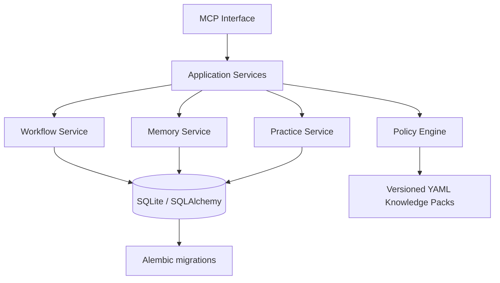

# Diseño De La Arquitectura De Conocimiento

## Overview

La solución agrega un workflow SDLC persistente y versionado, amplía la memoria existente sin romper `TEXPERIENCIA`, incorpora prácticas como entidad independiente y mantiene las políticas YAML como fuente de controles obligatorios. La inicialización instala únicamente la plantilla SDLC; no instala datos personales o proyectos ficticios.

## Architecture

El workflow define el proceso. Las políticas definen controles deterministas. Las prácticas entregan recomendaciones y no sustituyen los controles. La memoria conserva contexto técnico y requiere revisión antes de producir una práctica aprobada o una política.

## Components and Interfaces

### Workflow

- `WorkflowTemplateLoader`: valida la plantilla YAML con Pydantic.
- `WorkflowInitializer`: instala una versión ausente y asigna el workflow predeterminado a proyectos sin asignación.
- `WorkflowService`: consulta workflows, etapas, gates y crea personalizaciones por copia, incluyendo excepciones pendientes de aprobación.
- `WorkflowRepository`: persiste plantillas, etapas, gates y excepciones.

### Memory

Se mantiene `EngineeringExperience` como entidad compatible y se agregan `memory_type`, `technology`, `category`, `scope`, `author`, datos de revisión y relaciones. Los tipos son `INCIDENT`, `BUG`, `LESSON_LEARNED`, `RECOMMENDATION`, `PREFERENCE` y `POLICY`.

### Practices

`EngineeringPractice` es una entidad separada con activadores declarativos cerrados: evento, etapa, extensiones y componentes. `PracticeEngine` solo produce recomendaciones contextuales; nunca agrega reglas de bloqueo al `PolicyEngine`.

### MCP

Las herramientas actuales se conservan. Se agregan operaciones para consultar el workflow, personalizarlo, registrar memoria, revisar memoria, registrar prácticas y consultar prácticas aplicables. Las entradas usan DTO Pydantic estrictos y los UUID mantienen el contrato `string/uuid`.

## Data Models

La migración `0002_knowledge_architecture` crea:

- `TFLUJOSDLC`: versiones de workflows.
- `TETAPASDLC`: etapas ordenadas por workflow.
- `TGATESDLC`: gates y verificaciones declarativas.
- `TEXCEPCIONDLC`: excepciones con estado de aprobación.
- `TPRACTICA`: prácticas contextuales.

Agrega a `TPROYECTO` la referencia opcional `CFLUJOSDLC` y a `TEXPERIENCIA` los metadatos de memoria. Los cambios son aditivos y los datos legacy reciben el tipo `LESSON_LEARNED` cuando no exista clasificación previa.

## Default Workflow

La plantilla se define en `knowledge/sdlc/default.yaml` con código estable y versión. Contiene estas etapas:

1. `story_refinement`
2. `acceptance_criteria`
3. `dependency_review`
4. `design_approval`
5. `development`
6. `technical_review`
7. `testing`
8. `deployment_preparation`
9. `closure`

La inicialización usa claves naturales `(codigo, version)` y no actualiza registros existentes.

## Migration Strategy

1. Ejecutar `alembic upgrade head`.
2. Crear tablas nuevas y columnas nullable sin eliminar estructuras anteriores.
3. Backfill de metadatos legacy con valores explícitos y trazables.
4. Instalar el workflow predeterminado mediante una operación idempotente de aplicación.
5. Asignar el workflow a proyectos sin flujo, sin cambiar su contenido.
6. Validar conteos, referencias y comportamiento antes de iniciar MCP.

No se utiliza `drop_all`, no se reinicia SQLite y no se reemplaza una plantilla existente.

## Error Handling

- YAML de workflow inválido: error identificable de carga.
- Personalización de workflow inexistente: error de aplicación.
- Excepción sin aprobación: se conserva como no autorizada.
- Práctica pendiente: puede consultarse como pendiente, pero no bloquear.
- Migración inconsistente: el proceso falla sin ocultar el error y no continúa con un esquema parcial.

## Testing Strategy

- Unitario: loader, initializer, práctica contextual y copia de workflow.
- Integración: base nueva vacía, migración desde `0001`, preservación de filas, restart e idempotencia.
- Regresión: PASS, WARN, BLOCK y herramientas MCP existentes.
- Docker: volumen persistente y ausencia de SQLite o datos privados en la imagen.

## Decisiones Técnicas

1. Se conserva `TEXPERIENCIA` para evitar una migración destructiva y se clasifica mediante `TIPOMEMORIA`.
2. Las prácticas usan una tabla independiente para impedir que una recomendación se confunda con una política obligatoria.
3. Las plantillas se versionan y se personalizan por copia para proteger la reproducibilidad.
4. La inicialización de datos base ocurre después de Alembic y es idempotente.

## Riesgos e Incertidumbres

| Riesgo | Mitigación |
| --- | --- |
| SQLite limita algunos cambios de columnas | Usar migraciones aditivas y pruebas sobre copias de bases legacy. |
| Workflow customizado divergente | Mantener referencia al workflow origen y versiones explícitas. |
| Práctica convertida en bloqueo | Separar servicios, estados y motores; no reutilizar `action=block`. |
| Datos legacy sin autor | Mantener el campo nullable y registrar el origen de migración. |
