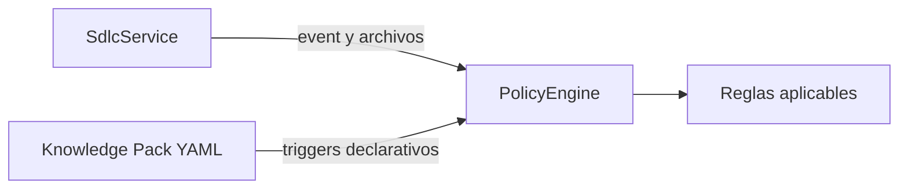

# Diseño De Sanitización De Knowledge Packs

## Overview

Se retira del código la inferencia de una extensión específica. La
aplicabilidad seguirá siendo responsabilidad del `PolicyEngine`, que ya recibe
triggers desde YAML. Los ejemplos y pruebas se renombran con artefactos y
evidencias ficticios.

## Architecture

`SdlcService` no inspecciona extensiones para elegir el evento. Si existe una
lista de archivos y no existe `context.event`, usa `file_change`; el YAML decide
si una regla coincide con el archivo.

## Components and Interfaces

- `src/sdlc_manager/application/services/sdlc_service.py`: elimina la
  condición específica y conserva inferencia genérica.
- `knowledge/rules/demo/forms.yaml`: conserva un ejemplo ficticio y genérico,
  sin nombres ni referencias organizacionales.
- `tests/`: usa rutas, identificadores y evidencias neutrales.
- `docs/` y `.sdd/`: describe la consulta de reglas del knowledge pack activo,
  sin presentar procesos internos.

## Data Models

No se cambian tablas, migraciones ni DTOs. Solo se modifican valores de ejemplo
en YAML, pruebas y documentación.

## Error Handling

La ausencia de una regla aplicable no produce una regla implícita. Los errores
de YAML continúan siendo rechazados por `PolicyLoader`.

## Testing Strategy

- Verificar carga de reglas genéricas.
- Verificar coincidencia por extensión declarada en YAML.
- Verificar que un archivo modificado sin evento explícito use `file_change`.
- Buscar referencias de la extensión y nombres específicos retirados.
- Ejecutar pytest, Ruff, mypy y validación SDD.

## Decisiones Técnicas

1. La configuración YAML es la única fuente de triggers de conocimiento.
2. Se conserva la prueba de extensión usando un sufijo ficticio para validar la
   capacidad del motor sin conservar conocimiento corporativo.
3. No se modifica el contrato MCP ni la persistencia.
