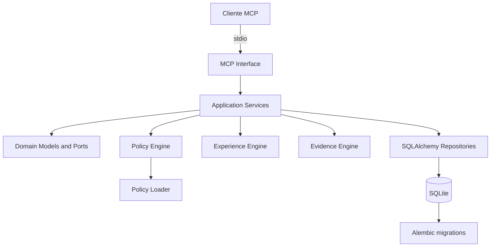

# Diseño del Servidor MCP MVP

## Resumen

El MVP se implementa como un proceso Python local que expone herramientas MCP sobre `stdio`. El adaptador MCP convierte entradas Pydantic en llamadas a servicios de aplicación; los servicios coordinan repositorios y motores deterministas. SQLite conserva el estado operativo y los archivos YAML conservan las políticas versionadas.

La implementación actual usa Python 3.12+, MCP Python SDK `2.3.0`, Pydantic `2.12.4`, SQLAlchemy `2.0.48`, Alembic `1.14.1`, pytest, Ruff, mypy, uv y Docker.

## Arquitectura



### Capas y responsabilidades

| Capa | Ubicación | Responsabilidad |
| --- | --- | --- |
| Domain | `src/sdlc_manager/domain/` | Dataclasses inmutables, enums y protocolos de repositorio. |
| Application | `src/sdlc_manager/application/` | Esquemas Pydantic y casos de uso de proyectos, historias, gates, experiencias y evidencias. |
| Engines | `src/sdlc_manager/engines/` | Evaluación de políticas, búsqueda de experiencias y validación de referencias. |
| Infrastructure | `src/sdlc_manager/infrastructure/` | SQLAlchemy, SQLite, Alembic, repositorios y lectura de YAML. |
| MCP | `src/sdlc_manager/mcp/` | Registro de herramientas, transporte `stdio` y adaptación estructurada. |

La capa Domain no importa MCP ni SQLAlchemy. El motor de políticas se puede utilizar directamente desde `SdlcService` o desde un adaptador futuro de Hooks y CI/CD.

## Componentes e interfaces

### Servicios

- `SdlcService.create_project`, `create_sprint` y `create_story` preparan contexto local.
- `SdlcService.get_applicable_rules` normaliza evento, etapa, archivos, componente y HU.
- `SdlcService.evaluate_gate` carga evidencias verificadas, ejecuta el motor y persiste `PolicyEvaluation`.
- `SdlcService.register_experience` crea experiencias `PENDING`; `search_experiences` usa búsqueda local.
- `SdlcService.register_evidence` crea evidencias `PENDING`; `verify_evidence` registra decisión humana.
- `SdlcService.analyze_user_story` y `start_sprint` calculan preparación verificable.

### Herramientas MCP

| Herramienta | Entrada principal | Salida |
| --- | --- | --- |
| `health_check` | Ninguna | Estado local, transporte y cantidad de políticas. |
| `list_policies` | `status`, `severity` opcionales | Lista de políticas YAML. |
| `get_applicable_rules` | `project_id`, evento, etapa, archivos y componente | Reglas aplicables. |
| `evaluate_gate` | `project_id`, `user_story_id`, `gate`, contexto | Decisión y trazabilidad. |
| `register_experience` | Campos de experiencia | Identificador y `PENDING`. |
| `search_experiences` | Texto, componente, etiquetas y revisión | Experiencias coincidentes. |
| `register_evidence` | Proyecto, HU, política, tipo y referencia | Evidencia `PENDING`. |
| `verify_evidence` | Proyecto, evidencia, revisor y aprobación | Evidencia actualizada. |
| `analyze_user_story` | Proyecto y HU | Problemas y reglas aplicables. |
| `start_sprint` | Proyecto y sprint opcional | Resumen de preparación y riesgos. |

Las herramientas auxiliares `create_project`, `create_sprint` y `create_user_story` permiten preparar datos ficticios desde un cliente MCP.

### Contrato de UUID en DTOs MCP

Los DTO de entrada mantienen `uuid.UUID` como tipo de dominio, pero usan un `BeforeValidator` en la frontera MCP. El validador acepta únicamente instancias `UUID` o cadenas y convierte las cadenas mediante `UUID(value)`. La configuración `strict=True` se conserva para los demás campos y el esquema JSON conserva `type: string` y `format: uuid` porque el tipo base sigue siendo `UUID`.

Este patrón evita que Pydantic rechace una cadena JSON válida antes de ejecutar el caso de uso, sin degradar el dominio a `str`. Se aplica a `project_id`, `user_story_id`, `sprint_id` y `evidence_id` en todos los modelos MCP que los reciben.

## Modelo de datos

Las políticas no son entidades SQLite: son configuración versionada en YAML validada como `PolicyRule`. Las siguientes entidades sí son persistentes:

| Modelo de dominio | Tabla física | Identificador físico |
| --- | --- | --- |
| `Project` | `TPROYECTO` | `CPROYECTO` |
| `Sprint` | `TSPRINT` | `CSPRINT` |
| `UserStory` | `THISTORIAUSUARIO` | `CHISTORIAUSUARIO` |
| `EngineeringExperience` | `TEXPERIENCIA` | `CEXPERIENCIA` |
| `Evidence` | `TEVIDENCIA` | `CEVIDENCIA` |
| `PolicyEvaluation` | `TEVALUACIONPOLITICA` | `CEVALUACION` |
| Auditoría de soporte | `TAUDITORIA` | `SAUDITORIA` |

Las llaves foráneas físicas usan `CPROYECTO`, `CSPRINT` y `CHISTORIAUSUARIO`. El código en inglés realiza el mapeo explícito mediante SQLAlchemy. Los campos de fecha usan prefijo `F` y los objetos físicos permanecen en español sin guiones bajos.

Las listas de criterios, dependencias, etiquetas, políticas relacionadas, reglas activadas y evidencias faltantes se almacenan como JSON serializado en SQLite. UUID se representa como texto de 36 caracteres.

## Políticas y evaluación

Los paquetes se encuentran en:

```text
knowledge/rules/
├── generic/sprint.yaml
├── generic/performance.yaml
└── demo/forms.yaml
```

`PolicyLoader` usa `yaml.safe_load` y un modelo Pydantic estricto. `PolicyEngine` solo acepta `equals`, `not_equals`, `contains`, `in`, `exists`, `file_extension_matches`, `all` y `any`. No existe evaluación de expresiones Python.

La evaluación sigue este flujo:

1. Filtrar políticas habilitadas por evento, etapa, extensiones y componente.
2. Evaluar condiciones sobre un contexto normalizado.
3. Cargar solo evidencias `VERIFIED` del proyecto y HU.
4. Determinar `BLOCK`, `WARN` o `PASS`, en ese orden de precedencia.
5. Persistir `PolicyEvaluation` con reglas, faltantes y explicación.

Una regla `block` sin evidencias requeridas bloquea cuando su condición es aplicable. Una regla `block` con todas las evidencias verificadas no bloquea.

## Gestión de experiencias

La persistencia utiliza consultas `LIKE` locales sobre título, contexto, problema, lección y etiquetas. No se incorporan FTS5 ni embeddings en el MVP para limitar la complejidad de migración y mantener el diseño preparado para un reemplazo posterior del puerto.

## Gestión de evidencias

`register_evidence` nunca crea una evidencia verificada. `verify_evidence` requiere un `verified_by` no vacío y cambia el estado a `VERIFIED` o `REJECTED`. La referencia se trata como texto; se rechazan rutas absolutas y segmentos `..`, y el sistema nunca abre el archivo referido.

## Persistencia y migraciones

La migración `migrations/versions/0001_initial.py` crea el esquema completo. El arranque nativo ejecuta `alembic upgrade head` cuando `SDLC_MANAGER_AUTO_MIGRATE=true`. Las pruebas usan `create_all` sobre bases temporales aisladas para evitar dependencia de estado externo.

## Manejo de errores

- YAML inválido: `PolicyLoadError` con archivo y causa de validación.
- Contexto o operador inválido: `PolicyEvaluationError`.
- Proyecto o HU inexistente: `ApplicationError` sin acceso cruzado.
- Referencia insegura: `EvidenceValidationError`.
- Argumentos MCP inválidos: rechazo de esquema Pydantic antes del servicio.
- UUID inválido, vacío o de tipo no permitido: rechazo del DTO antes del servicio.

Los errores esperados se exponen al cliente MCP; los logs no contienen secretos ni datos corporativos.

## Seguridad

- Sin `eval`, `exec`, shell ni comandos procedentes de YAML.
- Sin red ni telemetría durante la ejecución.
- Sin acceso a producción ni lectura arbitraria del anfitrión.
- Políticas no aprobadas no provocan bloqueos.
- Experiencias no revisadas no activan políticas.
- Consultas de proyecto e historia incluyen aislamiento por identificador de proyecto.
- Docker utiliza usuario no root y volumen dedicado.

## Testing Strategy

| Nivel | Cobertura |
| --- | --- |
| Unitario | Carga YAML, operadores, aplicabilidad, `PASS`, `WARN`, `BLOCK` y errores. |
| Integración | SQLite, ciclo de evidencias, experiencias, HU y aislamiento. |
| Protocolo | Descubrimiento e invocación MCP en memoria y mediante subprocess `stdio`. |
| Distribución | Construcción de imagen y descubrimiento de herramientas MCP desde Docker. |

Comandos oficiales:

```bash
uv run pytest
uv run ruff check .
uv run ruff format --check .
uv run mypy src
docker build -t sdlc-manager:latest .
```

## Decisiones técnicas

Las decisiones detalladas están en `.sdd/adrs/` y corresponden a MCP, Python, SQLite, políticas deterministas, Docker e independencia de Kiro. El SDK MCP se fijó en `2.3.0` porque la implementación usa `MCPServer` de la línea v2.

## Riesgos y mitigaciones

| Riesgo | Mitigación MVP |
| --- | --- |
| YAML mal formado | Validación estricta y carga abortada con error identificable. |
| Evidencia no confiable | Estado `PENDING` obligatorio y verificación explícita. |
| Cruce de proyectos | Filtros de repositorio por proyecto y llaves foráneas. |
| Pérdida de datos | Volumen Docker y migraciones versionadas. |
| Exceso de alcance corporativo | Sin integraciones, credenciales ni red en el MVP. |

