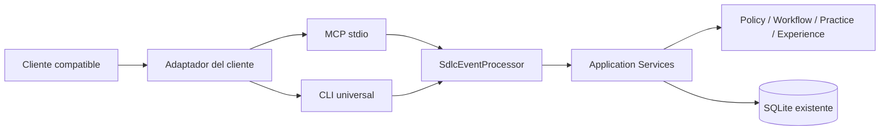

# Diseño De Integraciones Multiagente

## Overview

Las integraciones son superficies opcionales fuera de `src/sdlc_manager`. Cada
cliente recibe configuración MCP, instrucciones persistentes y, cuando existe
un contrato de eventos suficientemente documentado, un wrapper pequeño que
invoca el CLI universal. El núcleo conserva como única fuente de verdad al
`SdlcEventProcessor`.

## Architecture

La configuración de MCP usa el comando local `uv run --frozen sdlc-manager`.
Los wrappers ejecutan procesos sin shell y transportan únicamente JSON. La
variable `SDLC_MANAGER_COMMAND` permite seleccionar un ejecutable local en
entornos donde `sdlc-manager` no esté en `PATH`.

Si un hook no entrega timestamp, el adaptador usa `1970-01-01T00:00:00Z` como
valor explícito desconocido. Esto evita cambiar la huella del mismo evento en
un reintento y no representa una fecha real de operación.

## Components and Interfaces

### Contrato común

- `integrations/common/event_adapter.py`: genera eventos `file_changed` desde
  una envoltura nativa acotada y mantiene `event_id` mediante UUID5 cuando no
  existe un identificador nativo válido.
- `integrations/common/process_event.py`: ejecuta el CLI con stdin y conserva
  stdout JSON y el código de salida.
- `src/sdlc_manager/application/event_schemas.py`: valida el contrato real de
  `SdlcEvent`.
- `src/sdlc_manager/cli.py`: define los códigos 0/10/20/30/40/50/51.

### Kiro

Kiro tiene configuración MCP local y hooks de comandos. Se incluye un hook
`PostFileSave` desactivado por defecto, porque es seguro como advertencia pero no
constituye un bloqueo de operación. El adaptador traduce un payload de archivo
acotado a `file_changed`. El payload exacto recibido por una instalación real
debe verificarse antes de activar el archivo.

### Codex

Se incluye configuración TOML para MCP, instrucciones `AGENTS.md` de ejemplo y
un wrapper manual de eventos normalizados. No se afirma una API de hooks de
ciclo de vida porque su contrato exacto no se verificó en este entorno.

### OpenCode

Se incluye configuración JSONC con `mcp.servers`, instrucciones persistentes y
un wrapper manual. Los plugins se dejan fuera del flujo automático porque el
contrato de eventos del plugin no está verificado en este entorno.

### Claude Code

Se incluye configuración `.mcp.json`, instrucciones `CLAUDE.md` de ejemplo y
un wrapper manual. Claude Code documenta hooks `PreToolUse`, pero no se activa
un bloqueo automático en esta entrega porque no se probó contra el cliente real.

## Data Models

No se agregan tablas, columnas ni migraciones. Los wrappers usan el modelo
serializado existente:

- `event_id`: UUID estable durante reintentos.
- `event_type`: enum cerrado.
- `source_client`: metadato del adaptador, no identidad confiable.
- `project_id` y `user_story_id`: UUID opcionales según evento.
- `affected_files`: rutas relativas validadas por el núcleo.
- `context`: JSON acotado y no ejecutable.

## API Contracts

La herramienta MCP existente `process_sdlc_event` y el comando
`sdlc-manager event process --stdin` permanecen sin cambios. Los adaptadores no
exponen endpoints adicionales.

### Códigos de salida

| Código | Resultado | Uso del adaptador |
|---:|---|---|
| 0 | Informativo sin decisión | Continuar sin bloqueo |
| 10 | PASS | Continuar |
| 20 | WARN | Mostrar advertencia y continuar |
| 30 | BLOCK | Solicitar enforcement solo si el cliente lo soporta y está autorizado |
| 40 | REJECTED | Rechazar entrada; no tratar como PASS |
| 50 | ERROR_FATAL | Reportar error técnico y detener la automatización |
| 51 | ERROR_RETRYABLE | Reportar error técnico y permitir reintento con el mismo `event_id` |

## Error Handling

Los wrappers devuelven el JSON del CLI sin reinterpretarlo. Una falla al iniciar
el proceso produce un resultado estructurado de error en stdout y el detalle
operativo en stderr. Ningún error técnico se convierte en `PASS`.

## Testing Strategy

- Pruebas de contrato para los cuatro archivos MCP y el hook Kiro.
- Pruebas unitarias de UUID5, rutas y normalización.
- Pruebas de integración del wrapper Kiro con un ejecutable falso.
- Pruebas de persistencia y códigos mediante el CLI existente.
- Ejecución de pytest, Ruff, mypy y Docker disponibles.
- Validación real de cliente queda separada y no se declara ejecutada.

## Decisiones Técnicas

1. **Configuración fuera del núcleo:** evita dependencias y mantiene un motor
   cliente-independiente.
2. **CLI como interfaz de hooks:** permite operar sin iniciar una sesión MCP y
   reutiliza el mismo procesador, migraciones y SQLite.
3. **Kiro PostFileSave desactivado:** permite inspección segura sin afirmar
   enforcement antes de conocer el payload real de la instalación.
4. **Sin plugins no verificados:** evita inventar eventos o APIs privadas.

## Riesgos e Incertidumbres

- Los esquemas de hooks y configuración pueden cambiar por versión del cliente.
- El payload nativo de Kiro puede requerir un ajuste de mapeo después de una
  prueba real.
- MCP transporta decisiones, pero el cliente decide si las aplica como bloqueo.
- SQLite limita la concurrencia de varios hooks simultáneos.
