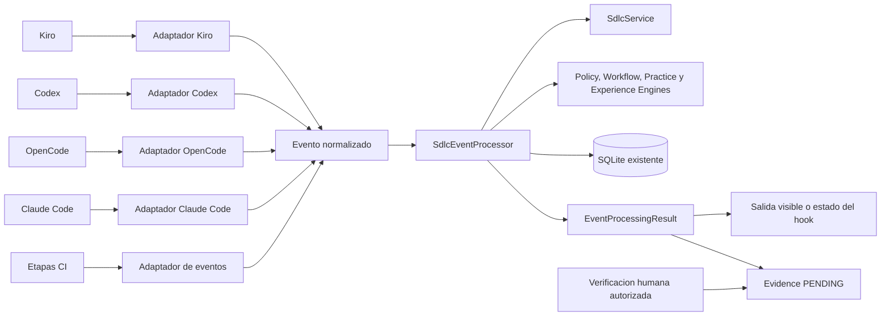

# Diseño de integración con proveedores

## Overview

La solución agrega adaptadores delgados para clientes y CI alrededor del núcleo existente. Los adaptadores convierten eventos nativos a `SdlcEvent`, invocan el CLI o MCP existente y traducen `EventProcessingResult` a la salida que el proveedor pueda consumir. No se replica la lógica de políticas, workflow, prácticas o experiencias.

La primera implementación debe priorizar una ruta vertical con un proveedor que tenga un contrato de hooks suficientemente explícito. La matriz inicial identifica a Claude Code como la opción con contrato de entrada, salida y decisión más detallado; Kiro, Codex y OpenCode requieren validación de versión y superficie antes de declarar enforcement.

## Arquitectura



### Flujo de procesamiento

1. El proveedor o CI emite un evento de su contrato oficial.
2. El adaptador valida tamaño, campos permitidos, rutas, UUID y alcance.
3. El adaptador genera o conserva `event_id`, establece `source_client` como metadata y normaliza fecha, etapa y archivos.
4. El adaptador invoca el CLI universal o la herramienta MCP sin ejecutar contenido del payload.
5. `SdlcEventProcessor` resuelve contexto, aplica idempotencia y delega en `SdlcService` y motores existentes.
6. El resultado se traduce a salida visible, warning o decisión de enforcement según el contrato del proveedor.
7. Si el resultado representa una comprobación, se registra evidencia `PENDING`; la verificación queda fuera del modelo y del proveedor.

## Componentes e interfaces

### Contratos existentes reutilizados

| Componente | Ruta | Uso |
|---|---|---|
| `SdlcEventProcessor` | `src/sdlc_manager/application/services/event_processor.py` | Procesamiento, idempotencia, auditoría y coordinación de servicios |
| `SdlcEvent` y `EventProcessingResult` | `src/sdlc_manager/application/event_schemas.py` | Entrada y salida normalizadas |
| CLI | `src/sdlc_manager/cli.py` | Entrada `stdin`, códigos estables y salida JSON |
| `IntegrationInstaller` | `src/sdlc_manager/infrastructure/integrations/installer.py` | Plan, instalación, backups, merge y retiro selectivo |
| MCP | `src/sdlc_manager/mcp/` | Herramientas y transporte `stdio` existentes |
| Evidencias | `src/sdlc_manager/engines/evidence_engine.py` y repositorios | Estado `PENDING`, verificación y auditoría |

### Interfaces nuevas de diseño

Los contratos siguientes se implementarán fuera de los motores de dominio:

```text
ProviderEventAdapter.normalize(raw_event, source_metadata) -> SdlcEvent
ProviderEventAdapter.render(result, provider_context) -> ProviderResponse
ProviderEventAdapter.capabilities() -> ProviderCapabilityReport
CiEventAdapter.from_job(job_context) -> SdlcEvent
EvidenceRecorder.record_pending(event, result) -> EvidenceReference
```

Cada adaptador debe ser una implementación independiente y no debe importar SDKs del proveedor dentro de `src/sdlc_manager`. Los wrappers existentes en `integrations/common/` deben reutilizarse antes de crear otros.

## Eventos y mapeo

| Señal normalizada | Uso | Evidencia |
|---|---|---|
| `session_started` | Recuperar contexto inicial sin bloquear | Opcional, `PENDING` solo si existe comprobación definida |
| `user_story_started` | Analizar preparación de HU | Resultado del workflow y evidencia pendiente si corresponde |
| `sdd_task_started` | Validar contexto de tarea o gate | Evidencia pendiente si el proveedor aporta referencia |
| `file_changed` | Recuperar experiencias, prácticas y políticas contextuales | No registrar evidencia por defecto |
| `task_completed` | Evaluar gate de cierre de tarea | Evidencia pendiente de la evaluación |
| `gate_evaluation_requested` | Evaluar gate explícito | Evidencia pendiente de la evaluación |
| `sprint_started` | Analizar preparación del sprint | Evidencia pendiente solo si se define el control |
| `incident_recorded` | Registrar contexto de incidente | La creación de experiencia requiere revisión explícita |

Los adaptadores no inventarán eventos para señales que el proveedor no exponga. Las etapas de CI usarán `context` limitado para identificar job, etapa y resultado, sin almacenar logs completos.

## Matriz de proveedor y estrategia

| Proveedor | Conectividad | Eventos automáticos candidatos | Enforcement | Diseño inicial |
|---|---|---|---|---|
| Kiro | MCP local y configuración JSON de usuario/proyecto | `SessionStart`, `PreToolUse`, `PostToolUse`, `FileSave`, `Pre Task Execution` según superficie | `PreToolUse` documenta validación/bloqueo; otros eventos dependen de salida | Adaptador JSON y hook de comando; probar versión instalada |
| Codex | MCP y `AGENTS.md`; plugin con MCP/hooks en escritorio instalado manualmente | Sesión o herramientas solo donde el contrato del plugin esté disponible | No asumir enforcement en CLI sin contrato verificable | MCP + instrucciones como ruta base; plugin separado y marcado `PARTIAL` |
| OpenCode | MCP y plugins locales/publicados | Hooks de plugin de sesión/prompt y eventos expuestos por la versión | Depende de la API de plugin y del punto de hook | Plugin observacional, sin afirmar bloqueo hasta prueba real |
| Claude Code | MCP local `stdio`; hooks con stdin/stdout JSON | `SessionStart`, `UserPromptSubmit`, `PreToolUse`, `PostToolUse`, `FileChanged`, `TaskCompleted` y otros documentados | `PreToolUse` permite decisión; `FileChanged` no bloquea | Adaptador vertical inicial; salida JSON limpia y decisión explícita |

Las referencias oficiales utilizadas para esta especificación son:

- Kiro MCP y configuración: `https://kiro.dev/docs/cli/mcp/` y `https://kiro.dev/docs/mcp/configuration/`.
- Kiro hooks: `https://kiro.dev/docs/hooks/types/`.
- Codex MCP, `AGENTS.md` y plugins: `https://developers.openai.com/learn/docs-mcp`, `https://developers.openai.com/cookbook/examples/codex/iterating-development-workflows-with-codex` y `https://developers.openai.com/plugins/build/plugins`.
- OpenCode MCP, configuración y plugins: `https://opencode.ai/docs/mcp-servers/`, `https://opencode.ai/docs/config/` y `https://opencode.ai/docs/plugins/`.
- Claude Code MCP y hooks: `https://docs.anthropic.com/en/docs/claude-code/mcp` y `https://docs.anthropic.com/en/docs/claude-code/hooks`.

Las URLs documentan capacidades del proveedor; no sustituyen las pruebas contra la versión instalada.

## Evidencias y verificación humana

El adaptador no cambia una evidencia a `VERIFIED`. El resultado automático debe guardar como mínimo el vínculo al evento, proyecto, HU, regla o gate y referencia del proveedor. El mecanismo de aprobación existente conserva la autoridad local; una futura identidad externa se incorporará detrás de un puerto, no dentro del adaptador.

La decisión de gate y el estado de evidencia se mantienen separados: `BLOCK` puede impedir el flujo del proveedor solo cuando existe enforcement oficial; `PENDING` siempre impide satisfacer un requisito de evidencia verificada.

## Instalación no destructiva

`IntegrationInstaller` mantiene los comandos `list`, `plan`, `install`, `status` y `uninstall`. La implementación de SPEC-010 debe conservar su namespace, backups, snapshots, escritura atómica, detección de conflictos y retiro selectivo. Los archivos JSONC o formatos no fusionables deben quedar en estado de merge manual, sin reescritura destructiva.

## Seguridad y errores

- El adaptador acepta solo JSON acotado y no ejecuta comandos, expresiones ni rutas del payload.
- Los comandos se invocan como listas de argumentos y los logs van a `stderr`.
- `source_client` identifica el origen técnico, no una identidad autorizada.
- Los errores de transporte, validación o timeout no se traducen a `PASS`.
- Los reintentos conservan `event_id` y permiten que el procesador devuelva `DUPLICATE`.
- El contexto de cada proyecto se mantiene aislado por los repositorios existentes.
- Las recomendaciones se deduplican por evento, regla, práctica y experiencia antes de mostrarse.

## Estrategia de pruebas

1. Pruebas unitarias de normalización por adaptador, límites, UUID, rutas y códigos.
2. Pruebas de contrato de configuraciones JSON, TOML y JSONC sin tocar perfiles reales.
3. Pruebas de instalación, reinstalación, actualización, conflicto, backup, rollback y desinstalación selectiva en directorios temporales.
4. Pruebas de integración con `SdlcEventProcessor`, SQLite temporal y persistencia de `PENDING`.
5. Pruebas de propagación que comprueben que la salida realmente llega al canal visible del proveedor.
6. Pruebas reales por proveedor solo cuando la versión esté instalada; de lo contrario, estado `PROBADO CON MOCK` o `NOT_TESTED`.
7. Pruebas de seguridad para payloads grandes, JSON inválido, comandos inyectados, rutas fuera del proyecto y errores técnicos.

## Decisiones técnicas

### Un solo procesador

Se reutiliza `SdlcEventProcessor` porque ya concentra normalización, idempotencia, auditoría y coordinación de servicios. Duplicar reglas en cuatro adaptadores produciría divergencias y rompería la compatibilidad MCP/CLI.

### CLI como frontera para hooks

Los hooks y scripts usan el CLI porque evita iniciar una sesión MCP y permite conservar códigos de salida. MCP permanece como interfaz de consulta y ejecución interactiva.

Los comandos de eventos se ejecutan con `uv --project` en lugar de `uv --directory`. Esto conserva el directorio de trabajo del proyecto del cliente para que los adaptadores puedan resolver `.sdlc-manager/config.json` sin depender de una variable de entorno global. En Codex, el payload real de `PostToolUse` puede transportar cambios mediante `tool_input.command`; el adaptador solo extrae las marcas estructuradas de `apply_patch` y no ejecuta ni interpreta shell arbitrario.

### Evidencia pendiente por defecto

Los eventos automáticos son señales técnicas, no aprobaciones humanas. Registrar `PENDING` reduce el riesgo de que un modelo o un proveedor declare cumplimiento sin verificación trazable.

### Capacidad declarada por versión

La instalación debe guardar o reportar la versión/superficie comprobada. Una capacidad documentada por el proveedor pero no ejecutada localmente no se declara `VALIDADO EN CLIENTE REAL`.

## Riesgos e incertidumbres

| Riesgo | Impacto | Mitigación |
|---|---|---|
| Cambios de contrato de hooks | Eventos o decisiones no interpretados | Fijar versión mínima, validar schema y mantener estado de capacidad |
| Salida no visible | El evento se persiste pero el agente no recibe la recomendación | Prueba de propagación por proveedor; degradar a `NOT_VERIFIED` |
| Concurrencia SQLite | Reintentos simultáneos o locks | Conservar `event_id`, timeouts limitados y documentar reintentos |
| Conflicto de configuración | Pérdida de ajustes del usuario | Plan previo, backup, merge selectivo, rollback y no reescritura de JSONC |
| Bloqueo falso | Interrupción indebida del desarrollo | Solo enforcement documentado; WARN por defecto y error separado |

## Correctness Properties

1. **Idempotencia:** el mismo `event_id` y huella no produce una segunda evaluación ni una segunda evidencia.
2. **No aprobación automática:** ninguna salida de proveedor cambia `PENDING` a `VERIFIED`.
3. **Aislamiento:** un evento de un proyecto no recupera ni modifica datos de otro proyecto.
4. **No degradación a PASS:** entradas inválidas, errores y capacidades no verificadas nunca producen `PASS`.
5. **Instalación aditiva:** instalar o retirar un proveedor conserva recursos que no pertenecen al namespace de SDLC Manager.

