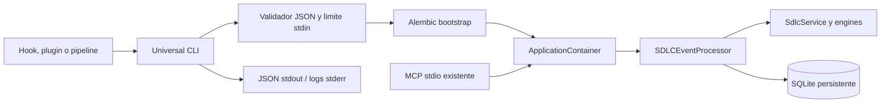

# Diseño De CLI Universal

## Overview

Se agrega una interfaz CLI delgada sobre `SdlcEventProcessor`. El comando `sdlc-manager event process --stdin` lee un JSON acotado, ejecuta el bootstrap de Alembic, construye el contenedor de aplicación y delega el procesamiento. La entrada sin argumentos conserva el servidor MCP actual.

## Architecture



La CLI no conoce reglas de negocio ni SDKs de clientes. El servidor MCP y la CLI construyen el mismo contenedor y utilizan el mismo procesador.

## Components and Interfaces

### `sdlc_manager.__main__`

- Sin argumentos: inicia el MCP existente.
- Con `event process --stdin`: invoca la frontera CLI.
- Devuelve el código de salida sin convertir errores técnicos en éxito.

### `sdlc_manager.cli`

- `run_cli(argv, stdin, stdout, stderr) -> int`.
- Lee hasta 1 MiB de stdin.
- Decodifica UTF-8 y JSON.
- Ejecuta `run_migrations` cuando `SDLC_MANAGER_AUTO_MIGRATE` está habilitado y luego `build_container(..., initialize_schema=False)`.
- Invoca `process_payload`.
- Serializa una única respuesta JSON a stdout.

## Contrato de comando

```text
sdlc-manager event process --stdin
```

La respuesta conserva el contrato `EventProcessingResult`. En entradas inválidas antes de construir el contenedor, `event_id` es `null` cuando no se puede obtener de forma segura.

## Códigos de salida

| Código | Constante | Significado |
| ---: | --- | --- |
| 0 | `INFO` | Evento procesado sin decisión de gate (`decision: null`). |
| 10 | `PASS` | Decisión PASS. |
| 20 | `WARN` | Decisión WARN. |
| 30 | `BLOCK` | Decisión BLOCK. |
| 40 | `REJECTED` | Entrada inválida, no soportada o conflicto de `event_id`. |
| 50 | `ERROR_FATAL` | Error técnico no reintentable. |
| 51 | `ERROR_RETRYABLE` | Error técnico reintentable. |

Los códigos son una señal para el adaptador, no una garantía universal de bloqueo. Cada cliente debe traducirlos según su modelo de Hooks o plugins.

## Data Models

No se agrega una tabla. La CLI reutiliza `TEVENTOSDLC`, `TAUDITORIA`, las migraciones existentes y el volumen configurado para SQLite.

## Error Handling

- JSON inválido: `REJECTED`, `INVALID_JSON`, código 40.
- UTF-8 inválido: `REJECTED`, `INVALID_UTF8`, código 40.
- Entrada sobre el límite: `REJECTED`, `INPUT_TOO_LARGE`, código 40.
- Resultado `REJECTED` o `UNSUPPORTED`: código 40.
- Resultado `ERROR` con `retryable: false`: código 50.
- Resultado `ERROR` con `retryable: true`: código 51.
- Fallo de bootstrap: `ERROR`, `CLI_BOOTSTRAP_ERROR`, código 50.

## Seguridad

- El tamaño máximo de stdin es 1 MiB.
- La validación de `SdlcEvent` permanece estricta.
- No se ejecuta contenido del payload.
- `source_client` sigue siendo metadata no confiable.
- stdout contiene únicamente JSON; los logs de Alembic y aplicación se envían a stderr.
- En Docker, `/app/data` debe ser escribible por `appuser`; no se requieren puertos ni red.

## Testing Strategy

- Pruebas de proceso separado para códigos de salida y JSON limpio.
- Pruebas de PASS, WARN, BLOCK e información.
- Pruebas de JSON inválido, UUID incorrecto y payload sobredimensionado.
- Pruebas de duplicado y conflicto entre procesos.
- Prueba de error de bootstrap y salida por stderr.
- Prueba Docker del CLI y regresión de MCP stdio.

## Decisiones Técnicas

1. Se usa `argparse` de la biblioteca estándar para evitar dependencias nuevas.
2. Se conserva el modo MCP sin argumentos para compatibilidad hacia atrás.
3. Se separan los códigos de decisión de los códigos de error; `decision: null` nunca se interpreta como PASS.
4. Se reutiliza el bootstrap Alembic existente para evitar dos formas de inicializar la base.

## Riesgos e Incertidumbres

- Un cliente puede ignorar códigos distintos de cero; la documentación exige un adaptador explícito.
- SQLite puede bloquearse bajo concurrencia alta; el MVP conserva esta limitación y no agrega un broker.
- Los permisos del volumen Docker dependen del propietario numérico del directorio montado.
