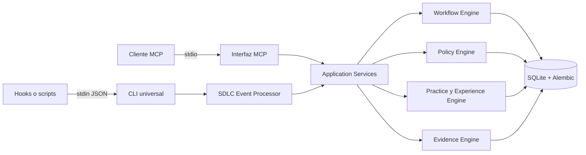

# SDLC Manager

Servidor MCP local para gobernanza del ciclo de vida de desarrollo de software, memoria técnica y evaluación determinista de políticas.

## Descripción

SDLC Manager permite consultar experiencias técnicas, detectar riesgos, registrar evidencias y evaluar gates con decisiones `PASS`, `WARN` o `BLOCK`. El MVP funciona sin servicios externos, credenciales externas ni conectividad de red durante su ejecución.

Las políticas se declaran en YAML y se validan con Pydantic. El motor de políticas no usa `eval`, `exec`, LLM ni acceso a sistemas de producción.

## Características

- Servidor MCP con transporte `stdio` basado en MCP Python SDK `2.3.0`.
- Persistencia local SQLite mediante SQLAlchemy 2.x y migraciones Alembic.
- Reglas deterministas con operadores cerrados.
- Memoria de experiencias con búsqueda textual local.
- Workflow SDLC predeterminado, versionado y personalizable por proyecto.
- Memoria clasificada y prácticas de ingeniería separadas de las políticas obligatorias.
- Evidencias `PENDING`, `VERIFIED` o `REJECTED` con verificación humana explícita.
- Aislamiento de datos por proyecto.
- Procesamiento idempotente de eventos SDLC normalizados.
- CLI universal para procesar eventos desde stdin sin iniciar MCP.
- Engineering Companion con recuperación contextual de experiencias y lector
  opcional de estado SDDNXP en modo lectura.
- Instalador no destructivo de integraciones por proyecto para Kiro, Codex,
  OpenCode y Claude Code.
- Paquetes de conocimiento genéricos y de demostración.
- Imagen Docker multi-stage con volumen persistente en `/app/data`.

## Arquitectura



La lógica de negocio se ejecuta desde servicios Python independientes del transporte MCP. Los detalles están en [docs/architecture.md](docs/architecture.md).

## Requisitos

- Python 3.12 o superior.
- `uv`.
- Docker, únicamente para la ejecución contenedorizada.

## Inicio rápido

SDLC Manager usa transporte MCP `stdio`. Por eso, **no se inicia como un
servicio permanente ni requiere un puerto**: el cliente MCP inicia el proceso
cuando necesita utilizarlo y lo finaliza al cerrar la sesión.

El flujo mínimo es:

1. Instalar el proyecto con `uv` o construir la imagen Docker.
2. Configurar SDLC Manager en el cliente MCP.
3. Reiniciar o recargar el cliente.
4. Confirmar que el cliente descubra `health_check` y las demás herramientas.
5. Invocar las herramientas desde el cliente. Las políticas no se ejecutan por
   el solo hecho de instalar el servidor.

La configuración MCP tampoco activa eventos automáticamente. Para activación
automática se requiere un Hook, plugin o script que invoque el CLI; esas
capacidades se documentan por cliente en [integrations/](integrations/).

## Directorio de ejecución

Los comandos de instalación nativa, migraciones, construcción Docker y
Docker Compose deben ejecutarse desde la raíz del repositorio, es decir, desde
el directorio que contiene `pyproject.toml`, `Dockerfile`, `alembic.ini` y
`knowledge/`:

```bash
cd /ruta/al/SDLC-Manager
```

En los ejemplos siguientes, mantenga abierta esa terminal ubicada en la raíz.
El cliente MCP también debe iniciar el servidor con esa raíz como directorio
de trabajo cuando se use la configuración nativa, porque allí se encuentran el
archivo `.env`, las migraciones y los paquetes de conocimiento.

## Instalación nativa

Requiere Python 3.12 o superior y `uv`.

```bash
git clone <URL_DEL_REPOSITORIO>
cd SDLC-Manager
uv sync --frozen
cp .env.example .env
mkdir -p data
uv run alembic upgrade head
```

La instalación crea únicamente el esquema y la plantilla SDLC predeterminada.
La memoria, los proyectos, las historias y las evidencias comienzan vacíos.

Después de instalar, **no es necesario dejar este comando corriendo**. Configure
el cliente MCP con el comando nativo indicado en [Configuración MCP](#configuración-mcp).

Para una comprobación manual del servidor:

```bash
uv run sdlc-manager
```

Este proceso queda esperando mensajes MCP. `stdout` pertenece al protocolo y
los logs se envían a `stderr`.

## Instalación con Docker

Requiere Docker.

```bash
cd /ruta/al/SDLC-Manager
docker build -t sdlc-manager:latest .
docker volume create sdlc-manager-data
```

Luego configure el cliente MCP usando el ejemplo Docker. El cliente iniciará
un contenedor por sesión y el volumen conservará la base SQLite:

```bash
docker run --rm -i \
  --network none \
  -v sdlc-manager-data:/app/data \
  sdlc-manager:latest
```

No ejecute ese comando en segundo plano para conectarlo al cliente; el cliente
debe administrarlo como un proceso `stdio`. La ejecución manual anterior sirve
únicamente para diagnóstico.

El directorio de datos predeterminado es `./data`. Se puede cambiar mediante `SDLC_MANAGER_DATABASE_URL`.

Para procesar un evento desde un Hook, script o pipeline en una instalación
nativa, ejecute desde la raíz del repositorio:

```bash
printf '%s\n' '{"event_id":"22222222-2222-4222-8222-222222222222","event_type":"session_started","source_client":"pipeline","timestamp":"2026-11-15T00:00:00Z","context":{}}' \
  | uv run sdlc-manager event process --stdin
```

El CLI escribe la respuesta JSON en `stdout` y los logs en `stderr`. Sus códigos de salida están documentados en [docs/universal-cli-validation.md](docs/universal-cli-validation.md).

Para procesar el mismo evento usando Docker, puede ejecutar el comando desde
cualquier directorio una vez construida la imagen y creado el volumen:

```bash
printf '%s\n' '{"event_id":"22222222-2222-4222-8222-222222222222","event_type":"session_started","source_client":"pipeline","timestamp":"2026-11-15T00:00:00Z","context":{}}' \
  | docker run --rm -i --network none \
      -v sdlc-manager-data:/app/data \
      sdlc-manager:latest event process --stdin
```

Docker Compose está disponible para desarrollo local, pero no es necesario para conectar un cliente MCP:

```bash
docker compose run --rm sdlc-manager
```

Consulta [docs/docker.md](docs/docker.md) para persistencia y migraciones.

## Configuración MCP

Elija **una** de estas modalidades y configure el cliente que utilice. No
configure simultáneamente el proceso nativo y Docker para el mismo cliente.

### Configuración nativa

Use esta configuración cuando `uv` y el repositorio estén disponibles en la
computadora donde corre el cliente:

```json
{
  "mcpServers": {
    "sdlc-manager": {
      "command": "uv",
      "args": ["run", "--frozen", "sdlc-manager"],
      "disabled": false
    }
  }
}
```

El ejemplo completo está en
[integrations/kiro/mcp.native.example.json](integrations/kiro/mcp.native.example.json).

### Configuración Docker

Use esta modalidad cuando el cliente deba ejecutar el servidor sin instalar
Python ni las dependencias del proyecto:

```json
{
  "mcpServers": {
    "sdlc-manager": {
      "command": "docker",
      "args": [
        "run", "--rm", "-i", "--network", "none",
        "-v", "sdlc-manager-data:/app/data",
        "sdlc-manager:latest"
      ],
      "disabled": false
    }
  }
}
```

El ejemplo completo está en
[integrations/kiro/mcp.docker.example.json](integrations/kiro/mcp.docker.example.json).

### Otros clientes

Las configuraciones e instrucciones específicas están disponibles en:

- [Kiro](integrations/kiro/README.md)
- [Codex](integrations/codex/README.md)
- [OpenCode](integrations/opencode/README.md)
- [Claude Code](integrations/claude-code/README.md)

Conectar el servidor permite descubrir herramientas, pero no activa
invocaciones automáticas. Los Hooks, plugins o scripts explícitos deben decidir
cuándo llamar cada herramienta.

### Activación contextual e integraciones

Desde la raíz del repositorio de SDLC Manager se puede revisar e instalar una
integración para otro proyecto sin modificar perfiles globales:

```bash
uv run sdlc-manager integrations list
uv run sdlc-manager integrations plan kiro claude-code --project-root /ruta/al/proyecto
uv run sdlc-manager integrations install kiro --project-root /ruta/al/proyecto --project-id UUID_DEL_PROYECTO
uv run sdlc-manager integrations status --project-root /ruta/al/proyecto
```

El instalador crea únicamente recursos propios de SDLC Manager, conserva las
entradas ajenas, genera backups cuando modifica archivos y permite retirar
selectivamente una integración:

```bash
uv run sdlc-manager integrations uninstall kiro --project-root /ruta/al/proyecto
```

La activación depende del mecanismo real del proveedor. El servidor MCP no se
mantiene levantado como daemon: el cliente lo inicia como proceso `stdio`.
Consulta [la validación del Engineering Companion](docs/engineering-companion-validation.md)
antes de habilitar hooks o plugins.

## Ejemplo de uso

1. Invocar `create_project` y `create_user_story` para preparar datos locales.
2. Invocar `get_applicable_rules` con `event=file_change` y los archivos del
   cambio; las reglas aplicables provienen del `knowledge pack` activo.
3. Invocar `evaluate_gate` en `task_completion`.
4. Registrar cada evidencia requerida con `register_evidence`.
5. Verificarla mediante `verify_evidence` y repetir la evaluación.
6. Consultar `get_sdlc_workflow` para revisar etapas y gates del proyecto.

## Pruebas y calidad

```bash
uv run pytest
uv run ruff check .
uv run ruff format --check .
uv run mypy src
```

La suite cubre el motor de políticas, persistencia SQLite, aislamiento por proyecto, ciclo de evidencias, memoria de experiencias e invocaciones MCP en memoria y por `stdio`.

## Documentación

- [Arquitectura](docs/architecture.md)
- [Motor de políticas](docs/policy-engine.md)
- [Herramientas MCP](docs/mcp-tools.md)
- [Validación del Event Processor](docs/event-processor-validation.md)
- [Validación del CLI universal](docs/universal-cli-validation.md)
- [Validación del Engineering Companion](docs/engineering-companion-validation.md)
- [Validación de Workflow Enforcement](docs/workflow-enforcement-validation.md)
- [Docker](docs/docker.md)
- [CI con GitHub Actions](docs/ci.md)
- [Roadmap](docs/roadmap.md)
- [Spec de arquitectura de conocimiento](.sdd/specs/knowledge-architecture/requirements.md)
- [AGENTS.md](AGENTS.md)

## Limitaciones del MVP

- No incluye embeddings ni búsqueda semántica.
- No integra gestores de trabajo externos, producción, servicios cloud ni autenticación externa.
- La aprobación de evidencias es local y requiere una llamada explícita.
- Las prácticas requieren revisión explícita y no producen bloqueos por sí mismas.
- Los clientes reales no fueron ejecutados en este entorno; las integraciones
  se validaron con contratos, procesos falsos y filesystem temporal.
- Los paquetes de conocimiento de demostración contienen únicamente datos ficticios.

## Seguridad

El servidor no ejecuta comandos desde YAML, no lee rutas arbitrarias, no modifica código mediante herramientas MCP, no realiza llamadas externas y no registra secretos. Las decisiones se almacenan con su evaluación y las evidencias mantienen su estado de verificación.

