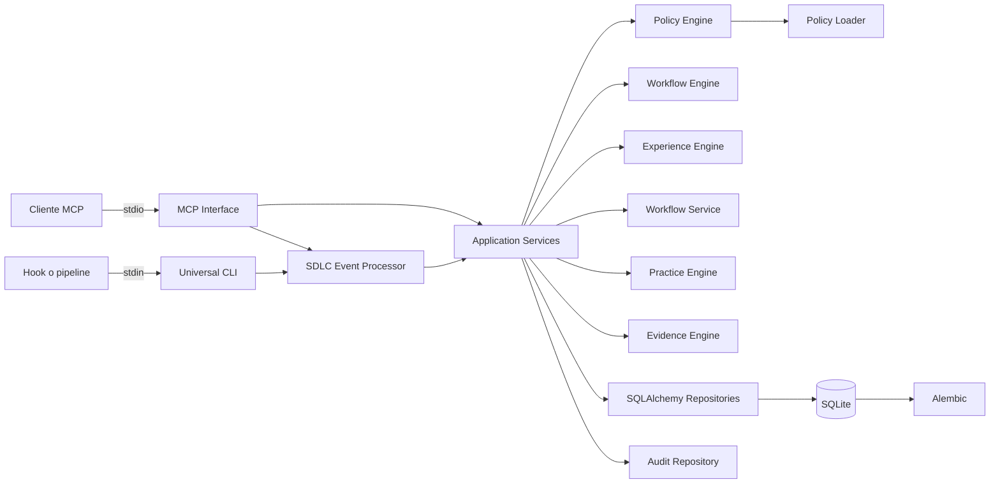
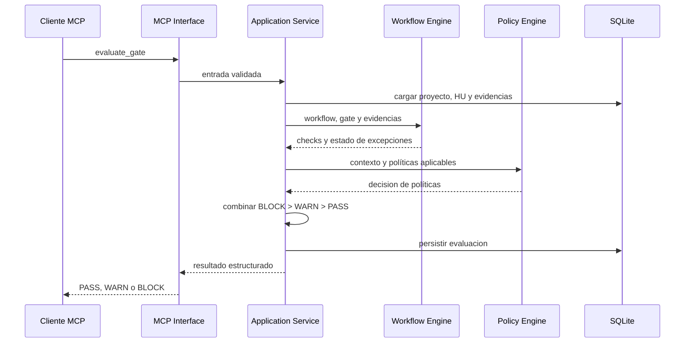

# Arquitectura

## Vista general

El servidor se ejecuta como proceso local. `stdout` contiene exclusivamente mensajes MCP y los logs se envían a `stderr`.

## Componentes

| Componente | Responsabilidad |
| --- | --- |
| Domain | Modelos inmutables, enumeraciones y contratos de repositorio. |
| Application | Casos de uso para proyectos, historias, workflows, experiencias, prácticas, evidencias y gates. |
| SDLC Event Processor | Valida, normaliza, procesa e idempotiza eventos sin depender del cliente. |
| Policy Engine | Aplicabilidad, operadores cerrados y decisión de políticas. |
| Workflow Engine | Evalua checks, evidencias, condiciones y excepciones del workflow. |
| Experience Engine | Búsqueda textual y filtro de experiencias revisadas. |
| Workflow Service | Consulta y personalización por copia de workflows versionados. |
| Practice Engine | Activación contextual de recomendaciones aprobadas sin bloqueos. |
| Evidence Engine | Validación de referencias y estados de verificación. |
| Policy Loader | Lectura `safe_load` y validación estricta de YAML. |
| Repositories | Conversión entre modelos de dominio y tablas SQLite, incluida la auditoría. |
| MCP Interface | Esquemas de entrada, registro de herramientas y adaptación de respuestas. |
| Universal CLI | Lectura JSON por stdin, códigos de salida y adaptación de respuestas sin iniciar MCP. |

## Flujo de evaluación

Las evidencias verificadas se consideran solo por tipo de evidencia y dentro del mismo proyecto e historia. Los estados `PENDING`, `REJECTED` y ausencia se informan por separado. Una respuesta generada por un modelo no cambia el estado de una evidencia.

Los eventos normalizados ingresan por `SDLCEventProcessor`. El procesador calcula una huella del payload validado, recupera resultados duplicados desde `TEVENTOSDLC` y delega la evaluación a los servicios existentes.

Los checks compartidos entre workflow y política se identifican mediante `workflow_checks`. El workflow conserva la evaluación obligatoria y la política mantiene la trazabilidad de la regla sin ejecutar la misma condición dos veces.

## Workflow SDLC

La plantilla `knowledge/sdlc/default.yaml` se instala después de las migraciones. Incluye nueve etapas y gates versionados. La instalación utiliza `(codigo, version)` como clave natural, por lo que reiniciar o actualizar no duplica ni sobrescribe una plantilla existente.

Un proyecto nuevo recibe la plantilla predeterminada. Una personalización crea un workflow derivado y reasigna el proyecto; la plantilla de origen permanece intacta. También puede incorporar excepciones con condiciones declarativas. Una excepción requiere responsable, referencia de aprobación, vigencia y una autoridad confiable inyectada; la implementacion predeterminada deniega el bypass.

## Registro de experiencias

`register_experience` almacena la experiencia como `PENDING` y conserva tipo, tecnología, categoría, alcance, autor y relaciones. La búsqueda excluye experiencias pendientes por defecto y puede incluirlas mediante `include_unreviewed=true`. Ningún registro de experiencia modifica automáticamente los archivos de políticas.

## Prácticas de ingeniería

`TPRACTICA` mantiene recomendaciones contextuales separadas de las políticas. Una practica debe ser revisada antes de activarse y su motor solo puede devolver recomendaciones; nunca produce `BLOCK`. Las practicas `PROJECT`, `PERSONAL` y `ORGANIZATION` se filtran por sus identificadores de alcance.

La búsqueda textual del MVP usa comparaciones locales `LIKE` sobre SQLite. FTS5 queda reservado para una fase posterior porque el volumen y el alcance inicial no justifican agregar otra superficie de migración.

## Relación con Kiro

Kiro actúa como cliente MCP. SDLC Manager conserva el conocimiento y calcula decisiones; no reemplaza el asistente, el repositorio ni los Hooks. La activación automática de eventos requiere Hooks o una integración explícita posterior.

## Persistencia

Las entidades persistentes son proyectos, sprints, historias de usuario, workflows, etapas, gates, excepciones, experiencias, prácticas, evidencias, evaluaciones y eventos procesados. `TAUDITORIA` registra evaluaciones de gates, bloqueos, cambios de evidencia y procesamiento de eventos con payload minimo. Las políticas permanecen versionadas en YAML. Las migraciones `0003_workflow_enforcement` y `0004_event_processor` son aditivas y conservan filas existentes. Las tablas usan nombres físicos en español y las relaciones incluyen identificadores de proyecto cuando corresponde.

