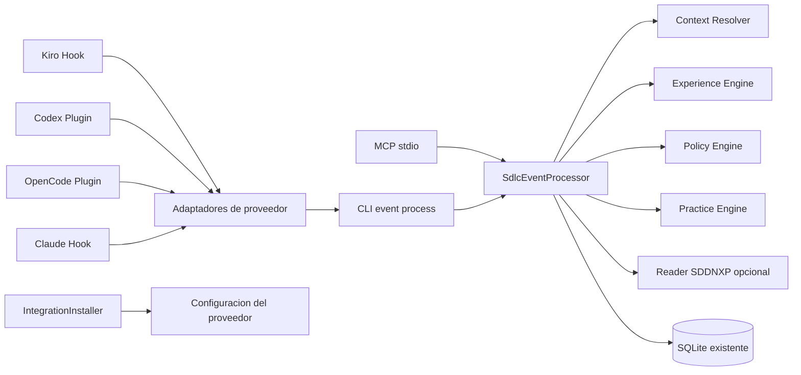

# Validación del Engineering Companion multiagente

## Alcance

Esta fase agrega activación contextual opcional para cuatro superficies de
integración, sin incorporar dependencias de sus SDK al núcleo. El motor de
eventos, las políticas, el workflow, la memoria y SQLite permanecen en
`src/sdlc_manager`.

Los resultados de los clientes se clasifican como:

- **IMPLEMENTADO:** existe código y configuración versionada.
- **PROBADO CON MOCK:** el contrato se comprobó con un proceso falso y
  filesystem temporal.
- **VALIDADO EN CLIENTE REAL:** se ejecutó contra la versión instalada del
  cliente.
- **NO VERIFICADO:** no se pudo comprobar la ejecución específica del cliente.

El transporte stdio utiliza el `MCPServer` del SDK oficial y un adaptador local
de streams para mantener la lectura y escritura no bloqueantes en el entorno
Python utilizado para la validación. El adaptador conserva JSON-RPC por linea,
reserva `stdout` para MCP y envia diagnostico a `stderr`.

## Arquitectura implementada



El flujo automático es informativo por defecto. Los adaptadores no duplican
reglas: normalizan payloads y hacen visible la respuesta del mismo
`SdlcEventProcessor` utilizado por MCP y el CLI.

## Cambios principales

### Contexto y memoria

- `src/sdlc_manager/application/services/context_resolver.py` infiere un
  componente acotado desde una ruta relativa o usa el componente declarado.
- `SdlcEventProcessor` busca experiencias aprobadas aplicables al proyecto y
  limita la respuesta a cinco referencias.
- La búsqueda por componente no exige que el término también aparezca en el
  título; esto permite recuperar una experiencia por su metadato técnico.
- `EventProcessingResult` incluye `sddnxp_context` opcional.

### Lectura opcional de SDDNXP

`src/sdlc_manager/infrastructure/sddnxp/reader.py` lee únicamente:

- `.sdd/config.yaml`.
- `spec.yaml` y presencia de `requirements.md`, `design.md` y `tasks.md`.

Si `.sdd/config.yaml` no existe, el resultado permanece sin contexto SDDNXP.
Si es inválido o ilegible, se informa `unavailable` y SDLC Manager continúa
con sus propios motores. No se ejecutan comandos, transiciones, aprobaciones ni
operaciones de memoria externa.

### Salida visible

`integrations/common/hook_runner.py` mantiene JSON en `stdout`, separa logs en
`stderr`, limita stdin a 1 MiB y ejecuta el CLI sin shell concatenado.

Claude Code usa además `hookSpecificOutput.additionalContext` mediante
`integrations/claude-code/hook_event.py`, que es el formato documentado para
inyectar contexto junto al resultado de una herramienta. Kiro conserva la
salida JSON del comando para que el hook pueda incorporarla a su contexto.

## Instalador seguro

La CLI agrega estos comandos. Se ejecutan desde la raíz del repositorio de SDLC
Manager y reciben el proyecto destino mediante `--project-root`:

```bash
sdlc-manager integrations list
sdlc-manager integrations plan kiro claude-code --project-root /ruta/al/proyecto
sdlc-manager integrations install kiro claude-code --project-root /ruta/al/proyecto --project-id UUID_DEL_PROYECTO
sdlc-manager integrations status --project-root /ruta/al/proyecto
sdlc-manager integrations uninstall kiro claude-code --project-root /ruta/al/proyecto
```

El alcance predeterminado es `project`. Para planificar o instalar en el
alcance de usuario se debe indicar explícitamente `--scope user`.

El instalador:

1. No ejecuta cambios durante `plan`.
2. Fusiona solamente la entrada `sdlc-manager` o recursos con marcadores
   propios.
3. Rechaza conflictos antes de sobrescribir archivos ajenos.
4. Usa escritura temporal, `fsync`, `os.replace` y backups al modificar un
   archivo existente.
5. Ejecuta un preflight y restaura el estado anterior si una escritura falla.
6. Retira solo entradas y archivos identificados como propios.
7. Conserva configuraciones de terceros y no elimina la base SQLite.
8. Trata `opencode.jsonc` como merge manual cuando no existe un
   `opencode.json`, porque no se preservan comentarios con `json.loads`.

El estado operativo y los backups se guardan bajo `.sdlc-manager/`, que es un
directorio propio del proyecto. No se incluyen bases SQLite, experiencias ni
secretos en los assets de integración.

## Matriz por proveedor

| Proveedor | Superficie instalada | Activación | Propagación contextual | Estado real |
|---|---|---|---|---|
| Kiro | MCP y hook `PostFileSave` | Comando del hook | stdout del comando | IMPLEMENTADO; PROBADO CON MOCK; NO VERIFICADO en cliente real |
| Claude Code | MCP, `PostToolUse` y bloque `CLAUDE.md` | Hook de comando | `hookSpecificOutput.additionalContext` | IMPLEMENTADO; PROBADO CON MOCK; NO VERIFICADO en cliente real |
| OpenCode | MCP y plugin local | Plugin `execute.after` | metadata del resultado de herramienta | IMPLEMENTADO; sintaxis no ejecutada en cliente real |
| Codex | Paquete de plugin, MCP, skill y hooks revisables | Depende de activar y confiar el plugin | depende del runtime del plugin | IMPLEMENTADO como paquete; NO VERIFICADO en cliente real |

La configuración MCP por sí sola no activa una consulta automática. Kiro y
Claude Code disponen de hooks documentados; OpenCode dispone de plugins y
hooks de servidor; el paquete Codex se entrega para revisión explícita y no
se registra silenciosamente en un perfil global.

## Instalación nativa

Desde la raíz de este repositorio:

```bash
uv sync --frozen
uv run alembic upgrade head
uv run sdlc-manager integrations plan kiro --project-root /ruta/al/proyecto
```

Después de revisar el plan:

```bash
uv run sdlc-manager integrations install kiro --project-root /ruta/al/proyecto --project-id UUID_DEL_PROYECTO
```

El identificador de proyecto es el UUID interno de SDLC Manager. No se debe
usar una identidad del proveedor como aprobación confiable.

Para procesar un evento sin MCP:

```bash
printf '%s\n' '{"event_id":"22222222-2222-4222-8222-222222222222","event_type":"session_started","source_client":"manual","timestamp":"2026-11-15T00:00:00Z","context":{}}' \
  | uv run sdlc-manager event process --stdin
```

## Instalación Docker

La imagen conserva la misma CLI y transporte MCP. Para una integración que
ejecute hooks en el host, el comando del hook debe invocar un CLI accesible en
el host o un wrapper equivalente. El contenedor MCP no se inicia en segundo
plano ni expone puertos.

```bash
docker build -t sdlc-manager:latest .
docker volume create sdlc-manager-data
```

Las configuraciones MCP Docker existentes permanecen disponibles en
`integrations/`. La persistencia se conserva en el volumen y las instalaciones
de integraciones no modifican `/app/data`.

## SDDNXP

SDDNXP conserva exclusivamente el gobierno de especificaciones, requisitos,
diseños, tareas, trazabilidad, aprobaciones y transiciones. SDLC Manager solo
usa un snapshot local de lectura para enriquecer `EventProcessingResult`.

La ausencia de SDDNXP no reduce la memoria, las prácticas, las políticas ni
el workflow propio de SDLC Manager. No existe dependencia de Engram ni ciclo de
llamadas entre ambos productos.

## Seguridad y límites

- No se usa `eval`, `exec`, shell ni comandos provenientes del payload.
- Las rutas recibidas se validan en el contrato de `SdlcEvent`.
- `source_client` solo identifica el transporte; no prueba identidad ni
  autoriza evidencias o excepciones.
- Los errores técnicos mantienen `decision: null` y códigos distintos de
  `PASS`.
- Los hooks instalados son informativos; no se declara enforcement real en un
  cliente no probado.
- SQLite conserva las limitaciones de concurrencia propias de un archivo
  local; varios hooks simultáneos pueden requerir reintento.
- No se agregan datos de demostración a instalaciones nuevas.

## Validación realizada

| Validación | Resultado |
|---|---|
| `uv run pytest -q` | 73 passed, 1 skipped, 28 warnings |
| Pruebas de companion e integraciones | 16 passed, 1 warning |
| `uv run ruff check .` | PASS |
| `uv run ruff format --check .` | PASS |
| `uv run mypy src integrations` | PASS, 52 archivos |
| Instalación y desinstalación de los cuatro proveedores en filesystem temporal | PASS |
| Prueba de stdout visible del hook Claude con proceso falso | PASS |
| `docker build -t sdlc-manager:latest .` | PASS |
| Persistencia CLI en Docker con volumen temporal | PASS, 1 prueba |
| `sddnxp validate . --json` | PASS, `valid: true`, sin issues |
| OpenCode 1.19.0 con configuración temporal | PASS parcial, `opencode debug config` terminó con código 0 |
| Kiro CLI 1.0.242 con configuración temporal | NO VERIFICADO, el cliente requirió autenticación |
| Cliente Kiro, Codex, OpenCode y Claude Code real | NO VERIFICADO |

El comando Docker y la validación SDD se ejecutan como parte del cierre de esta
fase cuando las herramientas están disponibles. La matriz anterior no declara
validación de cliente real basada únicamente en mocks.

## Referencias oficiales

- [Kiro: tipos de hooks](https://kiro.dev/docs/hooks/types/)
- [Kiro: MCP en CLI](https://kiro.dev/docs/cli/mcp/)
- [OpenCode: configuración](https://opencode.ai/docs/config/)
- [OpenCode: plugins](https://opencode.ai/docs/plugins/)
- [OpenCode: hooks de servidor](https://opencode.ai/docs/build/plugins/server)
- [Claude Code: hooks](https://code.claude.com/docs/en/hooks)
- [Claude Code: MCP](https://code.claude.com/docs/en/mcp)
- [OpenAI: plugins](https://developers.openai.com/plugins/concepts/plugins)

## Archivos relevantes

- `src/sdlc_manager/application/services/event_processor.py`
- `src/sdlc_manager/application/services/context_resolver.py`
- `src/sdlc_manager/infrastructure/integrations/installer.py`
- `src/sdlc_manager/infrastructure/sddnxp/reader.py`
- `integrations/common/hook_runner.py`
- `integrations/kiro/hooks/sdlc-file-save.installed.json`
- `integrations/claude-code/hook_event.py`
- `integrations/opencode/plugin/index.ts`
- `integrations/codex/plugin/`
- `tests/integration/test_engineering_companion.py`
