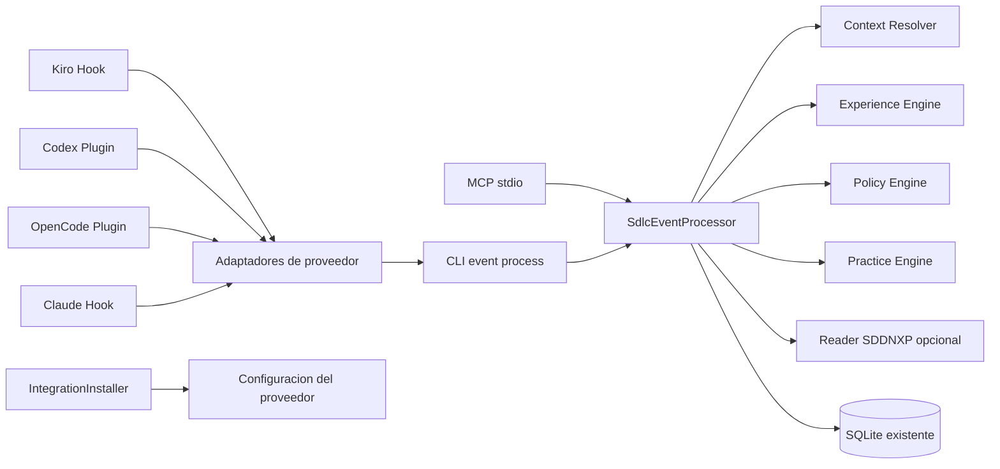

# Validación del Engineering Companion multiagente

## Alcance

Esta fase agrega activación contextual opcional para cuatro superficies de
integración, sin incorporar dependencias de sus SDK al núcleo. El motor de
eventos, las políticas, el workflow, la memoria y SQLite permanecen en
`src/sdlc_manager`.

Los resultados de los clientes se clasifican como:

- **IMPLEMENTADO:** existe código y configuración versionada.
- **PROBADO CON MOCK:** el contrato se comprobó con un proceso falso y
  filesystem temporal.
- **VALIDADO EN CLIENTE REAL:** se ejecutó contra la versión instalada del
  cliente.
- **NO VERIFICADO:** no se pudo comprobar la ejecución específica del cliente.

El transporte stdio utiliza el `MCPServer` del SDK oficial y un adaptador local
de streams para mantener la lectura y escritura no bloqueantes en el entorno
Python utilizado para la validación. El adaptador conserva JSON-RPC por linea,
reserva `stdout` para MCP y envia diagnostico a `stderr`.

## Arquitectura implementada



El flujo automático es informativo por defecto. Los adaptadores no duplican
reglas: normalizan payloads y hacen visible la respuesta del mismo
`SdlcEventProcessor` utilizado por MCP y el CLI.

## Cambios principales

### Contexto y memoria

- `src/sdlc_manager/application/services/context_resolver.py` infiere un
  componente acotado desde una ruta relativa o usa el componente declarado.
- `SdlcEventProcessor` busca experiencias aprobadas aplicables al proyecto y
  limita la respuesta a cinco referencias.
- La búsqueda por componente no exige que el término también aparezca en el
  título; esto permite recuperar una experiencia por su metadato técnico.
- `EventProcessingResult` incluye `sddnxp_context` opcional.

### Lectura opcional de SDDNXP

`src/sdlc_manager/infrastructure/sddnxp/reader.py` lee únicamente:

- `.sdd/config.yaml`.
- `spec.yaml` y presencia de `requirements.md`, `design.md` y `tasks.md`.

Si `.sdd/config.yaml` no existe, el resultado permanece sin contexto SDDNXP.
Si es inválido o ilegible, se informa `unavailable` y SDLC Manager continúa
con sus propios motores. No se ejecutan comandos, transiciones, aprobaciones ni
operaciones de memoria externa.

### Salida visible

`integrations/common/hook_runner.py` mantiene JSON en `stdout`, separa logs en
`stderr`, limita stdin a 1 MiB y ejecuta el CLI sin shell concatenado.

El procesador devuelve `recommendations` con mensajes acotados derivados de
prácticas aprobadas y experiencias aprobadas. Esto evita que un adaptador solo
transmita identificadores sin contenido útil.

Claude Code usa `hookSpecificOutput.additionalContext` mediante
`integrations/claude-code/hook_event.py`, que es el formato documentado para
inyectar contexto junto al resultado de una herramienta. Kiro usa la salida
estandar del comando; el hook produce texto contextual, pero la visibilidad
efectiva debe confirmarse en el cliente. El adaptador Kiro renderiza
recomendaciones como texto y el asset instalado es JSON valido. Codex usa el
mismo campo mediante hooks administrados por su plugin local. OpenCode usa el
hook de contexto del plugin y conserva el resultado estructurado en metadata.

## Instalador seguro

La CLI agrega estos comandos. Se ejecutan desde la raíz del repositorio de SDLC
Manager y reciben el proyecto destino mediante `--project-root`:

```bash
sdlc-manager integrations list
sdlc-manager integrations plan kiro claude-code --project-root /ruta/al/proyecto
sdlc-manager integrations install kiro claude-code --project-root /ruta/al/proyecto --project-id UUID_DEL_PROYECTO
sdlc-manager integrations status --project-root /ruta/al/proyecto
sdlc-manager integrations uninstall kiro claude-code --project-root /ruta/al/proyecto
sdlc-manager init codex --project-root /ruta/al/proyecto --project-id UUID_DEL_PROYECTO
```

El alcance predeterminado es `project`. Para planificar o instalar en el
alcance de usuario se debe indicar explícitamente `--scope user`.

El instalador:

1. No ejecuta cambios durante `plan`.
2. Fusiona solamente la entrada `sdlc-manager` o recursos con marcadores
   propios.
3. Rechaza conflictos antes de sobrescribir archivos ajenos.
4. Usa escritura temporal, `fsync`, `os.replace` y backups al modificar un
   archivo existente.
5. Ejecuta un preflight y restaura el estado anterior si una escritura falla.
6. Retira solo entradas y archivos identificados como propios.
7. Conserva configuraciones de terceros y no elimina la base SQLite.
8. Configura el MCP de Codex en alcance de proyecto sin modificar el perfil
   global del usuario.
9. Trata `opencode.jsonc` como merge manual cuando no existe un
   `opencode.json`, porque no se preservan comentarios con `json.loads`.

El estado operativo y los backups se guardan bajo `.sdlc-manager/`, que es un
directorio propio del proyecto. No se incluyen bases SQLite, experiencias ni
secretos en los assets de integración.

## Matriz por proveedor

| Proveedor | Superficie instalada | Activación | Propagación contextual | Estado real |
|---|---|---|---|---|
| Kiro | MCP y hooks `PostFileSave` y `PromptSubmit` | Comando de los hooks | stdout del comando; reconocimiento por la respuesta final no confirmado | PARTIAL; evento real, hook, procesador y experiencia comprobados, visibilidad efectiva en la respuesta del agente no confirmada |
| Claude Code | MCP, `PostToolUse` y bloque `CLAUDE.md` | Hook de comando | `hookSpecificOutput.additionalContext` | IMPLEMENTADO; PROBADO CON MOCK; NO VERIFICADO en cliente real |
| OpenCode | MCP y plugin local | Inicio de sesion y `execute.after` | Hook de contexto del plugin y `metadata.sdlcManager` | IMPLEMENTADO; PROBADO CON MOCK; NO VERIFICADO en cliente real |
| Codex | Marketplace local, plugin de proyecto y hooks empaquetados | `SessionStart`, `UserPromptSubmit` y `PostToolUse` | `hookSpecificOutput.additionalContext` | PARTIAL; la sesión creó `index.html`, pero el CLI no cargó el plugin local automáticamente en esta prueba |

La configuración MCP por sí sola no activa una consulta automática. Kiro y
Claude Code disponen de hooks documentados; OpenCode dispone de plugins y
hooks de servidor; Codex usa hooks de proyecto y requiere confianza explícita
cuando el cliente la solicita. El instalador no registra plugins ni modifica
perfiles globales.

## Instalación nativa

Desde la raíz de este repositorio:

```bash
uv sync --frozen
uv run alembic upgrade head
uv run sdlc-manager integrations plan kiro --project-root /ruta/al/proyecto
```

Después de revisar el plan:

```bash
uv run sdlc-manager integrations install kiro --project-root /ruta/al/proyecto --project-id UUID_DEL_PROYECTO
```

El identificador de proyecto es el UUID interno de SDLC Manager. No se debe
usar una identidad del proveedor como aprobación confiable.

Para procesar un evento sin MCP:

```bash
printf '%s\n' '{"event_id":"22222222-2222-4222-8222-222222222222","event_type":"session_started","source_client":"manual","timestamp":"2026-11-15T00:00:00Z","context":{}}' \
  | uv run sdlc-manager event process --stdin
```

## Instalación Docker

La imagen conserva la misma CLI y transporte MCP. Para una integración que
ejecute hooks en el host, el comando del hook debe invocar un CLI accesible en
el host o un wrapper equivalente. El contenedor MCP no se inicia en segundo
plano ni expone puertos.

```bash
docker build -t sdlc-manager:latest .
docker volume create sdlc-manager-data
```

Las configuraciones MCP Docker existentes permanecen disponibles en
`integrations/`. La persistencia se conserva en el volumen y las instalaciones
de integraciones no modifican `/app/data`.

## SDDNXP

SDDNXP conserva exclusivamente el gobierno de especificaciones, requisitos,
diseños, tareas, trazabilidad, aprobaciones y transiciones. SDLC Manager solo
usa un snapshot local de lectura para enriquecer `EventProcessingResult`.

La ausencia de SDDNXP no reduce la memoria, las prácticas, las políticas ni
el workflow propio de SDLC Manager. No existe dependencia de Engram ni ciclo de
llamadas entre ambos productos.

## Seguridad y límites

- No se usa `eval`, `exec`, shell ni comandos provenientes del payload.
- Las rutas recibidas se validan en el contrato de `SdlcEvent`.
- `source_client` solo identifica el transporte; no prueba identidad ni
  autoriza evidencias o excepciones.
- Los errores técnicos mantienen `decision: null` y códigos distintos de
  `PASS`.
- Los hooks instalados son informativos; no se declara enforcement real en un
  cliente no probado.
- SQLite conserva las limitaciones de concurrencia propias de un archivo
  local; varios hooks simultáneos pueden requerir reintento.
- No se agregan datos de demostración a instalaciones nuevas.

## Validación realizada

| Validación | Resultado |
|---|---|
| `uv run pytest -q` | 102 passed, 1 skipped, 38 warnings |
| Pruebas de companion, eventos e integraciones | 47 passed, 1 skipped, 3 warnings |
| `.venv/bin/ruff check .` | PASS |
| `.venv/bin/ruff format --check .` | PASS, 156 archivos |
| `uv run mypy src` | PASS, 43 archivos |
| `git diff --check` | PASS |
| Parseo JSON/TOML de assets de integración | PASS |
| Instalación y desinstalación de los cuatro proveedores en filesystem temporal | PASS |
| Hook Kiro instalado con salida contextual y `uv --frozen` en filesystem temporal | PASS |
| Adaptador OpenCode con payload nativo y proceso falso | PASS |
| `opencode debug config` en proyecto temporal | PASS, código 0 |
| Codex CLI con proyecto y SQLite temporales | PARTIAL; sesión real ejecutada y `index.html` creado |
| Hook Codex administrado con payload `PostToolUse` | PASS; recomendación emitida como `additionalContext` |
| Propagación al contexto visible de Codex | NOT VERIFIED; la respuesta final indicó que no recibió contexto |
| `docker build -t sdlc-manager:latest .` | NO REPETIDO después de estos cambios |
| Persistencia CLI en Docker con volumen temporal | Validación previa; no repetida en esta iteración |
| `sddnxp validate . --json` | PASS, `valid: true`, sin issues |
| `codex mcp get sdlc-manager` | PASS, servidor stdio habilitado |
| Kiro CLI 3.5.0 | PARTIAL; sesión real creó el HTML, el hook `PostFileSave` terminó correctamente y la base persistió `WARN` con la recomendación. La respuesta final indicó que no recibió contexto |
| OpenCode 1.19.0 en sesión real | PARTIAL; sesión real creó el HTML y el plugin persistió `WARN` con la recomendación, pero la respuesta final indicó que no recibió contexto |
| Claude Code 2.1.328 en sesión real | PARTIAL; el intento real fue bloqueado por `Not logged in`; el wrapper directo sí fue probado |

La matriz anterior distingue las pruebas del núcleo, los mocks de adaptadores y
la validación de configuración. Ningún mock se presenta como ejecución real de
un cliente.

## Referencias oficiales

- [Kiro: tipos de hooks](https://kiro.dev/docs/hooks/types/)
- [Kiro: MCP en CLI](https://kiro.dev/docs/cli/mcp/)
- [OpenCode: configuración](https://opencode.ai/docs/config/)
- [OpenCode: plugins](https://opencode.ai/docs/plugins/)
- [OpenCode: hooks de servidor](https://opencode.ai/docs/build/plugins/server)
- [Claude Code: hooks](https://code.claude.com/docs/en/hooks)
- [Claude Code: MCP](https://code.claude.com/docs/en/mcp)
- [OpenAI: plugins](https://developers.openai.com/plugins/concepts/plugins)

## Archivos relevantes

- `src/sdlc_manager/application/services/event_processor.py`
- `src/sdlc_manager/application/services/context_resolver.py`
- `src/sdlc_manager/infrastructure/integrations/installer.py`
- `src/sdlc_manager/infrastructure/sddnxp/reader.py`
- `integrations/common/hook_runner.py`
- `integrations/kiro/hooks/sdlc-file-save.installed.json`
- `integrations/claude-code/hook_event.py`
- `integrations/opencode/plugin/index.ts`
- `integrations/codex/plugin/`
- `tests/integration/test_engineering_companion.py`
