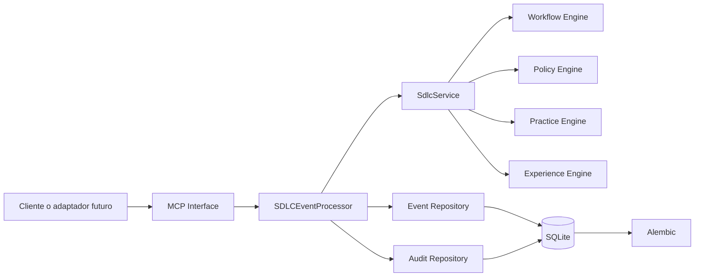

# Validación de SDLC Event Processor

## 1. Resumen de implementación

Se implementó `SdlcEventProcessor` como servicio de aplicación independiente del cliente. El procesador valida eventos normalizados, calcula una huella canónica, reutiliza `SdlcService`, `WorkflowEngine`, `PolicyEngine`, `PracticeEngine` y `ExperienceEngine`, persiste resultados idempotentes y registra auditoría mínima.

En la fase del Event Processor no se implementaron Hooks, plugins, adaptadores específicos ni CLI. La interfaz CLI se implementa en la spec `SPEC-005`.

## 2. Diagrama de arquitectura

El núcleo no importa SDKs de clientes. `source_client` se conserva como metadata y no concede identidad ni autorización.

## 3. Contrato de eventos

`SdlcEvent` está definido en `src/sdlc_manager/application/event_schemas.py` con Pydantic estricto y enum cerrado `SdlcEventType`.

| Campo | Validación |
| --- | --- |
| `event_id` | UUID; acepta texto JSON y se convierte a `uuid.UUID`. |
| `event_type` | Enum cerrado de ocho eventos soportados. |
| `source_client` | Texto de 1 a 64 caracteres alfanuméricos, punto, guion o guion bajo. No es una credencial. |
| `project_id` | UUID opcional, obligatorio en eventos con alcance de proyecto. |
| `user_story_id` | UUID opcional, obligatorio en eventos de HU, tareas y gates. |
| `stage` | Texto opcional de hasta 80 caracteres. |
| `timestamp` | Fecha ISO con zona horaria; se normaliza a UTC. |
| `affected_files` | Hasta 100 rutas relativas, sin rutas absolutas ni segmentos `..`. |
| `context` | JSON acotado a 64 claves, profundidad 5 y valores de tamaño limitado. |
| `schema_version` | Actualmente `1.0`. |

Los eventos inválidos no ejecutan casos de uso. `process_payload` devuelve `INVALID_EVENT` y, para un tipo desconocido con UUID válido, `UNSUPPORTED_EVENT_TYPE`.

## 4. Contrato de respuestas

`EventProcessingResult` incluye:

- `event_id`;
- `status`: `PROCESSED`, `DUPLICATE`, `UNSUPPORTED`, `REJECTED` o `ERROR`;
- `decision`: `PASS`, `WARN`, `BLOCK` o `null`;
- `triggered_rules`;
- `workflow_checks`;
- `applicable_practices`;
- `relevant_experiences`;
- `recommendations`: mensajes acotados para el canal contextual del proveedor;
- `missing_evidence`;
- `explanation`;
- `error_code`;
- `retryable`;
- `processed_at`.

Los eventos sin evaluación de gate usan `decision: null`; no se convierten en `PASS`.

## 5. Eventos soportados y acciones ejecutadas

| Evento | Acción |
| --- | --- |
| `session_started` | Registra el evento sin evaluación de gate. |
| `sprint_started` | Ejecuta `start_sprint`; devuelve `WARN` si existen historias con riesgos. |
| `user_story_started` | Ejecuta `analyze_user_story`; devuelve `BLOCK` si la HU está incompleta. |
| `sdd_task_started` | Analiza la HU; si recibe `context.gate`, evalúa el gate solicitado. |
| `file_changed` | Consulta políticas, prácticas y experiencias relevantes; mapea el evento a `file_change` para conservar compatibilidad con YAML. |
| `task_completed` | Evalúa `context.gate` o `task_completion`. |
| `gate_evaluation_requested` | Evalúa el gate declarado en `context.gate`. |
| `incident_recorded` | Registra el evento y consulta experiencias si el contexto incluye filtros. |

El procesador no crea automáticamente experiencias a partir de texto incompleto de un evento.

## 6. Estrategia de idempotencia

La huella SHA-256 se calcula sobre el evento ya validado y serializado de forma canónica. `TEVENTOSDLC` guarda el `event_id`, la huella, el estado, el resultado JSON y la fecha.

- Misma huella: devuelve el resultado persistido con `DUPLICATE`.
- Misma llave con otra huella: devuelve `EVENT_ID_REUSED` y no sobrescribe datos.
- Repeticiones: no ejecutan servicios, evaluaciones ni auditorías adicionales.

## 7. Persistencia y migraciones

La migración `migrations/versions/0004_event_processor.py` agrega de forma aditiva `TEVENTOSDLC` y la columna opcional `CPROYECTO` a `TEXPERIENCIA` para impedir que las memorias con alcance PROJECT crucen proyectos. No elimina datos, no incorpora brokers y mantiene SQLite como almacenamiento local.

El repositorio `SqlAlchemyEventRepository` se inicializa desde `ApplicationContainer`. La base nueva y la actualización desde `0003_workflow_enforcement` utilizan la misma tabla.

## 8. Seguridad y auditoría

- No se ejecuta código ni comandos del contexto.
- No se aceptan rutas absolutas ni segmentos `..`.
- `source_client` no se usa como identidad confiable.
- Los UUID, tipos, fechas y alcance se validan antes de procesar.
- Los errores inesperados devuelven `PROCESSING_ERROR`, `retryable: true` y nunca `PASS`.
- Un bloqueo funcional conserva `status: PROCESSED` y `decision: BLOCK`.
- La auditoría usa `TAUDITORIA` con `sdlc_event_processed`, el identificador del evento, estado, decisión y código de error. No se registra el payload completo ni secretos.

## 9. Herramientas MCP nuevas o modificadas

Se agregó `process_sdlc_event` en `src/sdlc_manager/mcp/server.py`. La herramienta utiliza el mismo `SdlcEventProcessor` disponible desde Python y mantiene las herramientas anteriores sin cambios.

Los UUID de sus argumentos se publican como `type: string` y `format: uuid`. La validación de Pydantic convierte las cadenas JSON a objetos UUID.

## 10. Resultados reales de las pruebas

Resultados ejecutados en el repositorio:

| Validación | Resultado |
| --- | --- |
| `uv run pytest -q` | 53 passed, 28 warnings de deprecación de `pytest-asyncio`. |
| Pruebas del Event Processor | 10 pruebas de integración: contrato, UUID, idempotencia, conflictos, gates, prácticas, errores, aislamiento y reinicio. |
| MCP por stdio | Descubrimiento e invocación de `process_sdlc_event`, incluyendo duplicado. |
| `uv run ruff check .` | Exitoso. |
| `uv run ruff format --check .` | 49 archivos formateados. |
| `uv run mypy src` | Sin errores en 35 archivos. |
| Migración Alembic | `0004_event_processor` agregada sobre `0003_workflow_enforcement`; preservación de datos verificada. |
| `uv lock --check` | Exitoso; dependencias resueltas sin cambios. |
| `sddnxp validate . --json` | Exitoso; `valid: true` y sin incidencias. |
| `docker build -t sdlc-manager:latest .` | Exitoso; imagen construida con Python 3.12 slim y usuario no root. |
| Prueba MCP en Docker con volumen | Exitoso; el segundo contenedor devolvió `DUPLICATE` para el mismo `event_id`. |

## 11. Limitaciones

1. La herramienta MCP usa el enum cerrado; un tipo desconocido es rechazado por el schema MCP, mientras que la frontera Python `process_payload` devuelve `UNSUPPORTED_EVENT_TYPE` estructurado.
2. No existe procesamiento asíncrono ni reintento automático.
3. No existe autoridad corporativa para validar identidad de `source_client`.
4. La persistencia local no implementa coordinación entre procesos concurrentes más allá de la llave primaria SQLite.

## 12. Preparación para desarrollar el CLI universal

El CLI universal ya está disponible mediante `sdlc-manager event process --stdin`. Lee JSON desde stdin, delega en `SdlcEventProcessor.process_payload` y no requiere un LLM, conexión de red ni código adicional de reglas. La respuesta JSON conserva los mismos estados, decisiones y códigos de error.

## 13. Compatibilidad futura con Kiro, Codex, OpenCode y Claude Code

La compatibilidad futura se obtiene mediante adaptadores que traduzcan los eventos de cada cliente al contrato `SdlcEvent`. Ningún adaptador debe duplicar reglas, manipular SQLite directamente ni usar `source_client` como autorización.

MCP continúa siendo el adaptador disponible en la fase del Event Processor. La CLI posterior y los futuros Hooks o plugins deben invocar el mismo procesador, no crear motores alternos.
