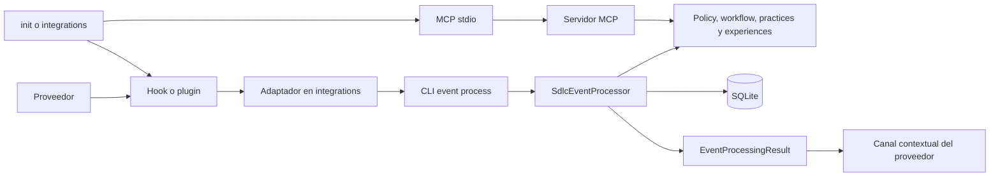

# Auditoria de arquitectura del framework

## Alcance y fecha

Esta auditoria revisa el estado del framework al 23 de noviembre de 2026,
incluyendo el nucleo compartido, la CLI, el bootstrap de proyectos, MCP, los
adaptadores de eventos, el instalador y las superficies automaticas de Kiro,
Codex, OpenCode y Claude Code.

El objetivo arquitectonico acordado es:

```text
Evento real -> hook o plugin -> adaptador -> procesador comun
-> experiencia o practica recuperada -> recomendacion visible
```

La verificacion de un cliente externo requiere ejecutar ese cliente. La
existencia de un archivo de configuracion, una prueba unitaria o una respuesta
de SQLite no demuestra por si sola visibilidad para el agente.

## Arquitectura verificada



| Area | Estado | Evidencia | Conclusión |
| --- | --- | --- | --- |
| Dominio y contratos | PASS | `src/sdlc_manager/domain/`, `application/event_schemas.py` | El núcleo no depende de SDKs de proveedores. |
| Servicios y motores | PASS | `application/services/`, `engines/` | Las reglas no se duplican en los adaptadores. |
| Persistencia | PASS | SQLite, Alembic y repositorios aislados por proyecto | El procesamiento conserva idempotencia y aislamiento. |
| MCP stdio | PASS | `src/sdlc_manager/mcp/`, pruebas MCP en memoria y stdio | MCP expone capacidades consultables y ejecutables. |
| CLI universal | PASS | `event process --stdin` y `hook <proveedor>` | Los hooks invocan el mismo procesador sin iniciar una sesion MCP. |
| Bootstrap | PASS | `sdlc-manager init <proveedor>` | Instala por proyecto MCP, hooks o plugin cuando existe una superficie implementada. |
| Runtime portable | PASS | Wheel incluye `sdlc_manager`, `integrations`, `knowledge` y `migrations` | El instalador usa `uv` en checkout y `sdlc-manager` cuando esta instalado. |
| Instalacion aditiva | PASS | Preflight, backups, snapshots, merge y rollback | No sobrescribe configuracion ajena sin conflicto explicito. |
| Identidad del proyecto | PASS | `.sdlc-manager/config.json` y resolucion desde `project_root` o `cwd` | Los hooks no dependen obligatoriamente de una variable global. |
| SDDNXP | PASS parcial | `infrastructure/sddnxp/reader.py` | Solo lectura; no modifica artefactos ni aprobaciones. |
| CI generico | PARTIAL | La CLI acepta eventos normalizados | No existe aun un adaptador especifico para formatos de CI. |

## Matriz por proveedor

| Proveedor | Instalacion | Evento automatico | Procesador y recuperacion | Canal de salida | Estado de cliente |
| --- | --- | --- | --- | --- | --- |
| Codex | PARTIAL: marketplace local, plugin y recursos propios; requiere confianza del proyecto | PASS de implementacion: `SessionStart`, `UserPromptSubmit`, `PostToolUse` dentro del plugin | PASS con wrapper comun y `additionalContext` | Implementado con `hookSpecificOutput.additionalContext` | PARTIAL: la sesion real debe confirmar carga del plugin y visibilidad del contexto. |
| Kiro | PASS: MCP y hooks de proyecto | PASS de implementacion: `PostFileSave` y `PromptSubmit` | PASS en fixture y prueba real del hook de archivo | stdout del hook | PARTIAL: el hook real produjo recomendacion, pero la respuesta del agente no confirmo su recepcion. |
| OpenCode | PASS: MCP, plugin local e instrucciones | PASS de implementacion: inicio de sesion y `execute.after` | PASS con `event process --stdin` | `session.hook("context")` agrega texto al sistema; metadata conserva resultado | NOT TESTED en cliente real. |
| Claude Code | PASS: MCP, hooks de ciclo de vida e instrucciones | PASS de implementacion: `SessionStart`, `UserPromptSubmit`, `PostToolUse` | PASS con wrapper comun | `hookSpecificOutput.additionalContext` | NOT TESTED en cliente real por falta de licencia disponible. |
| Kiro Crew | UNSUPPORTED como proveedor independiente | Usa la superficie de Kiro si la sesion ejecuta sus hooks | No tiene adaptador separado | Depende de Kiro CLI | No se declara integracion independiente. |

Los estados `PASS de implementacion` y `NOT TESTED` no equivalen a una
validacion E2E. Las referencias de contrato deben contrastarse con la version
instalada: [Codex plugins y hooks](https://developers.openai.com/plugins/build/plugins),
[Kiro hooks](https://kiro.dev/docs/hooks/types/),
[OpenCode plugins](https://opencode.ai/docs/plugins/) y
[Claude Code hooks](https://code.claude.com/docs/en/hooks).

## Cambios corregidos en esta auditoria

1. Se elimino la dependencia de rutas absolutas del checkout en los comandos
   instalados. El runtime usa `uv --project` durante el desarrollo y el
   ejecutable `sdlc-manager` cuando proviene de un wheel instalado.
2. Se incluyeron `integrations`, `knowledge` y `migrations` en el wheel para
   que el instalador y la CLI funcionen fuera del repositorio fuente.
3. Se agrego el comando `sdlc-manager hook` para que todos los hooks Python
   pasen por una frontera CLI estable y compartida.
4. Se agregaron hooks de inicio de sesion y envio de prompt donde el proveedor
   lo permite, sin quitar los hooks de terceros.
5. OpenCode ahora entrega la recomendacion mediante su hook de contexto, no
   solamente como metadata del resultado de una herramienta.
6. Claude Code ahora entrega el contenido de las recomendaciones, no solo el
   conteo de practicas y experiencias.
7. La resolucion del proyecto usa el `project_root` del evento para leer
   `.sdlc-manager/config.json`, con fallback controlado a `cwd` y al entorno.
8. La copia de assets ignora bytecode y la reinstalacion conserva archivos
   administrados sin intentar leer `__pycache__` como texto.

## Validaciones ejecutadas

| Validacion | Resultado |
| --- | --- |
| Suite completa | `102 passed, 1 skipped, 38 warnings` |
| Integraciones y adaptadores | `47 passed, 1 skipped, 3 warnings` |
| Ruff lint | PASS |
| Ruff format | PASS, 159 archivos |
| Mypy | PASS, 43 archivos de `src` |
| `git diff --check` | PASS |
| Construccion de wheel | PASS |
| Contenido del wheel | PASS: `integrations/`, `knowledge/` y `migrations/` presentes |
| Persistencia, idempotencia, rollback y merge | PASS en pruebas temporales |
| Visibilidad en cliente real | PARTIAL: Kiro observado; Codex con evidencia previa; OpenCode y Claude no ejecutados en esta auditoria |

El test omitido es el de Docker, habilitado solo con
`SDLC_MANAGER_RUN_DOCKER_TESTS=1`. Las advertencias corresponden a deprecaciones
de `pytest-asyncio` y a la configuracion heredada de `prepend_sys_path` de
Alembic; no produjeron fallos.

## Brechas restantes

### P0: evidencia E2E por cliente

La cadena completa solo se puede declarar cerrada después de que cada cliente
ejecute una tarea en un proyecto temporal y la respuesta del propio agente
confirme la recomendacion. El codigo ya prepara la cadena, pero la evidencia
externa no puede fabricarse desde las pruebas del repositorio.

### P1: versiones y contratos operativos

- Repetir Codex con la version actualmente instalada y confirmar confianza de
  hooks, `additionalContext` y no duplicacion.
- Ejecutar una sesion real de OpenCode y comprobar que el hook `context` inyecta
  el texto antes del siguiente turno.
- Ejecutar una sesion real de Claude Code y comprobar `additionalContext` en
  `SessionStart`, `UserPromptSubmit` y `PostToolUse`.
- Repetir Kiro con `PromptSubmit` y confirmar si stdout se incorpora al contexto;
  `PostFileSave` por si solo no demostro visibilidad para el agente.

### P1: adaptador de CI

La frontera universal ya permite enviar eventos JSON normalizados, pero falta
un adaptador con contrato de entrada para una plataforma CI concreta. No se
debe inventar un formato hasta seleccionar la plataforma y los eventos
requeridos.

### P2: enforcement

Las integraciones actuales son informativas. `BLOCK` solo debe detener una
accion en un evento oficialmente soportado para enforcement y después de una
prueba real. No se habilita bloqueo por defecto.

## Uso recomendado

Primero crear o recuperar el proyecto y su UUID mediante MCP. Después revisar
el plan e instalar en un proyecto temporal o en el proyecto autorizado:

```bash
uv run sdlc-manager integrations plan codex kiro opencode claude-code \
  --project-root /ruta/al/proyecto

uv run sdlc-manager init codex \
  --project-root /ruta/al/proyecto \
  --project-id UUID_DEL_PROYECTO
```

La opcion `--project-id` es necesaria para que el evento automatico pueda
aislar la memoria y las practicas del proyecto. Si ya existe
`.sdlc-manager/config.json`, `init` puede reutilizarlo.

## Veredicto

**Estado global: PARTIAL.**

La arquitectura objetivo esta implementada en el repositorio: framework
instalable, CLI/bootstrap, MCP, procesador comun y superficies automaticas por
proveedor. El cierre aun no puede declararse `PASS` porque la visibilidad en
clientes externos es una propiedad de ejecucion y faltan pruebas reales de
OpenCode y Claude Code, ademas de repetir Codex y Kiro con las versiones
actuales.
