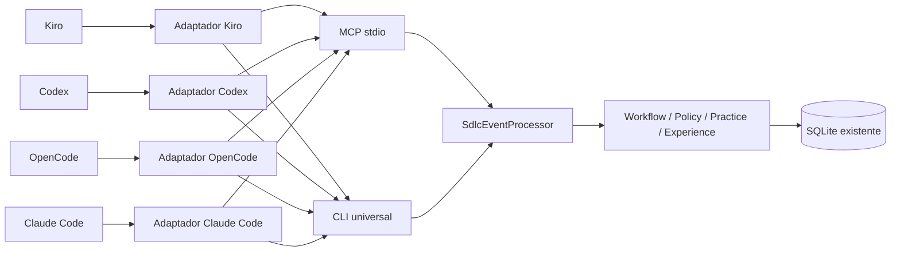

# Validación De Integraciones Multiagente

## 1. Arquitectura

SDLC Manager mantiene un único núcleo cliente-independiente:



Los adaptadores están fuera de `src/sdlc_manager`. La única implementación de
reglas continúa en `SdlcEventProcessor`, `SdlcService` y sus motores. Las
integraciones no agregan tablas, migraciones, dependencias de clientes ni datos
de demostración.

## 2. Adaptadores implementados

| Cliente | Archivos principales | Estado |
|---|---|---|
| Kiro | `integrations/kiro/mcp.*`, `integrations/kiro/hooks/sdlc-file-save.example.json`, `integrations/kiro/kiro_event_adapter.py` | MCP **IMPLEMENTADO**; hook **PROBADO CON MOCK**; cliente real **NO VALIDADO EN CLIENTE REAL** |
| Codex | `integrations/codex/mcp.config.example.toml`, `AGENTS.sdlc-manager.md`, `process_event.py` | MCP e instrucciones **IMPLEMENTADO**; wrapper **PROBADO CON MOCK**; cliente real **NO VALIDADO EN CLIENTE REAL** |
| OpenCode | `integrations/opencode/opencode.config.example.jsonc`, `process_event.py` | MCP e instrucciones **IMPLEMENTADO**; wrapper **PROBADO CON MOCK**; cliente real **NO VALIDADO EN CLIENTE REAL** |
| Claude Code | `integrations/claude-code/.mcp.json.example`, `CLAUDE.md.example`, `process_event.py` | MCP e instrucciones **IMPLEMENTADO**; wrapper **PROBADO CON MOCK**; cliente real **NO VALIDADO EN CLIENTE REAL** |

La guía común está en `integrations/common/sdlc-manager-instructions.md`.
El contrato común de normalización y ejecución está en
`integrations/common/event_adapter.py` y `integrations/common/process_event.py`.

## 3. Archivos de configuración

### Kiro

Los archivos existentes `integrations/kiro/mcp.native.example.json` y
`integrations/kiro/mcp.docker.example.json` conservan la configuración MCP
stdio. El hook de ejemplo usa `PostFileSave`, está desactivado y no bloquea.
Kiro documenta hooks de archivo, acciones de comando y MCP local en:

- [Kiro Hooks](https://kiro.dev/docs/hooks/)
- [Kiro acciones de hooks](https://kiro.dev/docs/hooks/actions/)
- [Kiro MCP en CLI](https://kiro.dev/docs/cli/mcp/)

### Codex

`integrations/codex/mcp.config.example.toml` usa un servidor local stdio.
También se documenta el comando equivalente:

```bash
codex mcp add sdlc-manager -- uv run --frozen sdlc-manager
```

La plantilla `AGENTS.sdlc-manager.md` no debe sobrescribir un `AGENTS.md`
existente. Las referencias utilizadas son [Codex MCP](https://developers.openai.com/codex/mcp),
[Codex Skills](https://developers.openai.com/plugins/concepts/skills) y
[Codex Plugins](https://developers.openai.com/plugins/concepts/plugins).

### OpenCode

`integrations/opencode/opencode.config.example.jsonc` usa la estructura
`mcp.servers` con un servidor `local` y carga la guía común con `instructions`.
Las referencias son [OpenCode MCP servers](https://opencode.ai/docs/mcp-servers),
[OpenCode instructions](https://opencode.ai/docs/instructions/) y
[OpenCode plugins](https://opencode.ai/docs/plugins/).

### Claude Code

`integrations/claude-code/.mcp.json.example` declara el servidor stdio. La
plantilla `CLAUDE.md.example` se incorpora manualmente después de revisar las
instrucciones del proyecto. Las referencias son [Claude Code MCP](https://docs.anthropic.com/en/docs/claude-code/mcp),
[Claude Code hooks](https://docs.anthropic.com/en/docs/claude-code/hooks),
[Claude Code memory](https://docs.anthropic.com/en/docs/claude-code/memory) y
[Claude Code skills](https://docs.anthropic.com/en/docs/claude-code/skills).

## 4. Capacidades por cliente

| Capacidad | Kiro | Codex | OpenCode | Claude Code |
|---|---|---|---|---|
| MCP local stdio | IMPLEMENTADO | IMPLEMENTADO | IMPLEMENTADO | IMPLEMENTADO |
| Instrucciones persistentes | IMPLEMENTADO | IMPLEMENTADO | IMPLEMENTADO | IMPLEMENTADO |
| Wrapper CLI | IMPLEMENTADO | IMPLEMENTADO | IMPLEMENTADO | IMPLEMENTADO |
| Consulta de workflow y memoria mediante MCP | IMPLEMENTADO en el núcleo | IMPLEMENTADO en el núcleo | IMPLEMENTADO en el núcleo | IMPLEMENTADO en el núcleo |
| Persistencia después de reiniciar el proceso | PROBADO en CLI/Docker; cliente no real | PROBADO en CLI/Docker; cliente no real | PROBADO en CLI/Docker; cliente no real | PROBADO en CLI/Docker; cliente no real |
| Evento nativo automáticamente traducido | PostFileSave de ejemplo, PROBADO CON MOCK | NO VERIFICADO | NO VERIFICADO | NO VERIFICADO |
| Hook de bloqueo configurado | NO IMPLEMENTADO | NO VERIFICADO | NO VERIFICADO | NO IMPLEMENTADO |
| Validación en cliente real | NO VALIDADO EN CLIENTE REAL | NO VALIDADO EN CLIENTE REAL | NO VALIDADO EN CLIENTE REAL | NO VALIDADO EN CLIENTE REAL |

La configuración MCP no implica invocación automática. Las instrucciones
persistentes tampoco constituyen enforcement. El cliente debe ofrecer un hook o
plugin documentado y probado para aplicar una decisión.

## 5. Matriz de eventos soportados

| Evento `SdlcEvent` | MCP/CLI manual | Kiro | Codex | OpenCode | Claude Code |
|---|---|---|---|---|---|
| `session_started` | IMPLEMENTADO | Wrapper manual | Wrapper manual | Wrapper manual | Wrapper manual |
| `sprint_started` | IMPLEMENTADO | Wrapper manual | Wrapper manual | Wrapper manual | Wrapper manual |
| `user_story_started` | IMPLEMENTADO | Wrapper manual | Wrapper manual | Wrapper manual | Wrapper manual |
| `sdd_task_started` | IMPLEMENTADO | Wrapper manual | Wrapper manual | Wrapper manual | Wrapper manual |
| `file_changed` | IMPLEMENTADO | PostFileSave, PROBADO CON MOCK | No verificado | No verificado | No verificado |
| `task_completed` | IMPLEMENTADO | Wrapper manual | Wrapper manual | Wrapper manual | Wrapper manual |
| `gate_evaluation_requested` | IMPLEMENTADO | Wrapper manual | Wrapper manual | Wrapper manual | Wrapper manual |
| `incident_recorded` | IMPLEMENTADO | Wrapper manual | Wrapper manual | Wrapper manual | Wrapper manual |

Los wrappers manuales esperan un evento normalizado por stdin. No adivinan
eventos a partir de texto libre ni ejecutan valores del contexto.

Cuando un payload de hook no contiene timestamp, el adaptador usa
`1970-01-01T00:00:00Z` como valor desconocido para conservar la misma huella en
reintentos; no debe interpretarse como la fecha real del evento.

## 6. Matriz de advertencias y bloqueos

| Resultado CLI | MCP | Kiro | Codex | OpenCode | Claude Code |
|---:|---|---|---|---|---|
| 0 informativo | Devolver resultado | Continuar | Continuar | Continuar | Continuar |
| 10 `PASS` | Devolver resultado | Continuar | Continuar | Continuar | Continuar |
| 20 `WARN` | Mostrar advertencia | Mostrar sin bloquear | Mostrar sin bloquear | Mostrar sin bloquear | Mostrar sin bloquear |
| 30 `BLOCK` | Devolver decisión | No bloquear con `PostFileSave`; enforcement futuro requiere prueba real | No aplicar enforcement no verificado | No aplicar enforcement no verificado | No aplicar enforcement no verificado |
| 40 rechazado | Rechazar | Reportar error | Reportar error | Reportar error | Reportar error |
| 50 error fatal | Error técnico | Detener automatización | Detener automatización | Detener automatización | Detener automatización |
| 51 reintentable | Error técnico | Reintentar con el mismo `event_id` | Reintentar con el mismo `event_id` | Reintentar con el mismo `event_id` | Reintentar con el mismo `event_id` |

Un resultado `decision: null` no es `PASS`. Ninguna integración instalada aquí
puede afirmar un bloqueo efectivo en un cliente real.

## 7. Pruebas ejecutadas y resultados

Se agregaron `tests/integration/test_multiagent_integrations.py` con:

- Estructura de los cuatro archivos MCP.
- Estructura y estado desactivado del hook Kiro.
- UUID estable durante reintentos.
- Rechazo de UUID de proyecto y rutas no seguras.
- Traducción Kiro con un ejecutable falso.
- stdout JSON limpio, stderr separado y preservación del código de salida.
- Sobrescritura controlada de `source_client` por el wrapper de transporte.

Resultados reales de esta fase:

| Comando | Resultado |
|---|---|
| `uv run pytest tests/integration/test_multiagent_integrations.py -q` | `7 passed`, `1 warning` |
| `uv run pytest -q` | `64 passed`, `1 skipped`, `28 warnings` antes de habilitar Docker |
| `SDLC_MANAGER_RUN_DOCKER_TESTS=1 uv run pytest -q` | `65 passed`, `28 warnings` |
| `uv run ruff check .` | Exitoso |
| `uv run ruff format --check .` | Exitoso; `60 files already formatted` |
| `uv run mypy src` | Exitoso; sin errores en 36 archivos fuente |
| `uv run mypy integrations` | Exitoso; sin errores en 8 archivos de adaptadores |
| `sddnxp validate . --json` | Exitoso; `valid: true`, `issues: []` |
| `docker build -t sdlc-manager:latest .` | Exitoso |
| `uv run alembic` con configuración y SQLite temporales | Exitoso; migraciones 0001 a 0004 aplicadas |

La validación en cliente real no forma parte de los resultados locales.

## 8. Funcionalidades no verificadas

- Ejecución contra Kiro, Codex, OpenCode y Claude Code instalados localmente.
- Payload exacto de hooks de cada cliente en la versión instalada por el
  usuario.
- Enforcement real de `BLOCK` en un flujo de edición o herramienta.
- Compatibilidad de cada configuración con futuras versiones del cliente.
- Concurrencia de varios hooks simultáneos sobre la misma SQLite.

Estas limitaciones se declaran como **NO VERIFICADO** o **NO VALIDADO EN CLIENTE
REAL**, no como fallas del núcleo.

## 9. Instrucciones de instalación en Linux

Desde la raíz del repositorio:

```bash
uv sync --frozen
uv run alembic upgrade head
```

Para verificar el servidor sin cliente externo:

```bash
printf '%s\n' '{"event_id":"00e57f27-4f4c-47d0-be96-84f1b7162a99","event_type":"session_started","source_client":"manual","timestamp":"2026-11-15T00:00:00Z","context":{}}' | uv run sdlc-manager event process --stdin
```

Para probar el wrapper de Kiro se requiere un UUID de proyecto local:

```bash
export SDLC_MANAGER_PROJECT_ID=00e57f27-4f4c-47d0-be96-84f1b7162a99
printf '%s\n' '{"path":"artifacts/sample.artifact","session_id":"demo-session"}' | uv run python integrations/kiro/kiro_event_adapter.py
```

Los comandos de cada cliente se documentan en su `README.md`. La instalación
no copia archivos automáticamente y la desinstalación consiste en retirar la
configuración del cliente, sin tocar `/app/data` ni la base local.

## 10. Riesgos y próximos pasos

1. Probar Kiro real con un hook `PostFileSave` para confirmar el payload y luego
   documentar el resultado.
2. Verificar una versión concreta de cada cliente y fijar sus esquemas de
   configuración.
3. Diseñar un hook de enforcement autorizado por cliente; no reutilizar un
   hook informativo como bloqueo.
4. Agregar pruebas de persistencia con dos procesos concurrentes y documentar
   los límites de SQLite.
5. Mantener los wrappers como adaptadores del contrato, no como otra ubicación
   de reglas.

La primera integración vertical queda preparada para Kiro mediante MCP y un
hook informativo de archivo. Las otras tres quedan preparadas para instalación
MCP, consulta de memoria y ejecución CLI manual, sin afirmar automatización que
no haya sido verificada.
