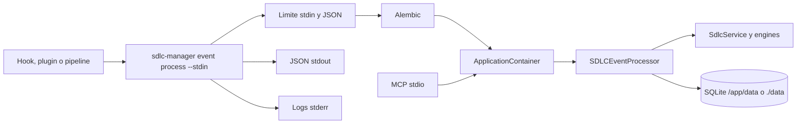

# Validación del CLI universal

## 1. Resumen

Se implementó el comando `sdlc-manager event process --stdin` como una interfaz delgada sobre `SdlcEventProcessor`. El CLI no inicia MCP, no depende de un modelo de IA y reutiliza los servicios, migraciones, SQLite y auditoría existentes.

La ejecución sin argumentos conserva el servidor MCP actual:

```bash
uv run sdlc-manager
```

## 2. Arquitectura



El CLI y MCP comparten el mismo núcleo. Ninguna regla se duplica en la interfaz.

## 3. Comando y entrada

```bash
sdlc-manager event process --stdin
```

Ejemplo nativo:

```bash
printf '%s\n' '{"event_id":"22222222-2222-4222-8222-222222222222","event_type":"session_started","source_client":"pipeline","timestamp":"2026-11-15T00:00:00Z","context":{}}' \
  | uv run sdlc-manager event process --stdin
```

El CLI lee un solo objeto JSON, con un límite de 1 MiB. El evento se valida mediante `SdlcEvent` y la respuesta conserva el contrato `EventProcessingResult`.

## 4. Respuesta JSON

Ejemplo de evento informativo:

```json
{
  "event_id": "22222222-2222-4222-8222-222222222222",
  "status": "PROCESSED",
  "decision": null,
  "triggered_rules": [],
  "workflow_checks": [],
  "applicable_practices": [],
  "relevant_experiences": [],
  "recommendations": [],
  "missing_evidence": [],
  "explanation": "Sesion registrada sin evaluacion de gate",
  "error_code": null,
  "retryable": false,
  "processed_at": "2026-11-15T00:00:00Z"
}
```

`decision: null` representa un evento procesado sin gate y nunca se interpreta como `PASS`.

## 5. Códigos de salida

| Código | Significado | Uso |
| ---: | --- | --- |
| `0` | Información | Evento procesado sin decisión de gate. |
| `10` | PASS | Decisión determinista `PASS`. |
| `20` | WARN | Advertencia o práctica contextual. |
| `30` | BLOCK | Control obligatorio incumplido. |
| `40` | REJECTED | JSON, UUID, contrato, evento no soportado o conflicto de `event_id`. |
| `50` | ERROR_FATAL | Error técnico no reintentable o fallo de bootstrap. |
| `51` | ERROR_RETRYABLE | Error técnico marcado como reintentable. |

Los códigos no sustituyen el contrato del cliente. Un Hook puede ignorar el código, mostrar una advertencia o bloquear una operación según sus propias reglas. Por ello, cada adaptador debe interpretar tanto el código como el JSON de respuesta.

## 6. Persistencia e idempotencia

El CLI ejecuta Alembic cuando `SDLC_MANAGER_AUTO_MIGRATE=true` y construye el contenedor con `initialize_schema=False`. No ejecuta `drop_all`, no reinicializa la base y no sobrescribe personalizaciones.

La tabla `TEVENTOSDLC` conserva la huella SHA-256 del evento normalizado:

- misma huella: devuelve `DUPLICATE` sin repetir efectos;
- misma `event_id` con otra huella: devuelve `EVENT_ID_REUSED` y código `40`;
- procesos separados: comparten el resultado a través de SQLite.

## 7. Seguridad

- stdin se limita a 1 MiB;
- UTF-8 y JSON se validan antes de procesar;
- UUID, rutas y contexto mantienen la validación Pydantic existente;
- no se ejecutan comandos, expresiones ni rutas recibidas;
- `source_client` no concede permisos;
- stdout contiene exclusivamente el JSON de respuesta;
- los logs de migración y errores operativos se envían a stderr;
- no se registra el payload completo ni secretos.

## 8. Ejecución con Docker

Construcción:

```bash
docker build -t sdlc-manager:latest .
```

Procesamiento CLI:

```bash
printf '%s\n' '{"event_id":"22222222-2222-4222-8222-222222222222","event_type":"session_started","source_client":"pipeline","timestamp":"2026-11-15T00:00:00Z","context":{}}' \
  | docker run --rm -i --network none \
      -v sdlc-manager-data:/app/data \
      sdlc-manager:latest event process --stdin
```

El directorio montado debe ser escribible por el usuario no root de la imagen (`UID 10001`). El contenedor no abre puertos y no requiere red durante la ejecución.

## 9. Compatibilidad MCP

El servidor MCP sigue iniciando con:

```bash
uv run sdlc-manager
```

Las herramientas existentes y `process_sdlc_event` no cambian sus contratos. La prueba de protocolo MCP continúa ejecutándose junto con la suite del CLI.

## 10. Resultados reales

| Validación | Resultado |
| --- | --- |
| `uv run pytest -q` | 57 passed, 1 prueba Docker omitida por defecto, 28 warnings de deprecación de `pytest-asyncio`. |
| `uv run pytest tests/integration/test_cli.py -q` | 4 passed, 1 omitida por defecto. |
| `SDLC_MANAGER_RUN_DOCKER_TESTS=1 uv run pytest tests/integration/test_cli.py::test_cli_runs_in_docker_with_persistent_volume -q` | 1 passed. |
| Ejecución nativa `event process --stdin` | Exit code `0`, JSON válido en stdout y logs de Alembic en stderr. |
| `docker build -t sdlc-manager:latest .` | Exitoso. |

## 11. Limitaciones

- SQLite puede devolver bloqueo bajo concurrencia elevada; no se agrega un broker ni un coordinador distribuido.
- Los códigos de salida no obligan por sí solos a un cliente externo a bloquear una operación.
- La identidad de `source_client` no se valida contra una autoridad corporativa.
- No se implementan Hooks, plugins ni adaptadores específicos de Kiro, Codex, OpenCode o Claude Code.

## 12. Preparación para adaptadores multiagente

Los futuros adaptadores deben:

1. traducir su evento al contrato `SdlcEvent`;
2. invocar el CLI o MCP sin duplicar reglas;
3. conservar `event_id` entre reintentos;
4. interpretar el JSON y el código de salida según su propio contrato;
5. registrar la decisión externa sin convertir una recomendación en un bloqueo no autorizado.

La implementación actual deja el núcleo independiente de cada cliente y mantiene una única ruta de evaluación.
