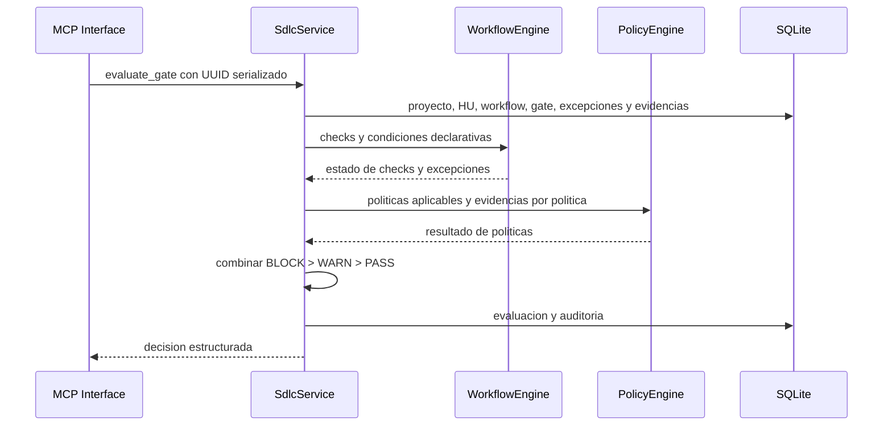

# Validación de Workflow Enforcement

## Alcance

Esta validación convierte el workflow definido en `knowledge/sdlc/default.yaml` en un componente ejecutable, sin crear `SDLCEventProcessor`, CLI ni Hooks. La implementación mantiene el transporte MCP `stdio`, los contratos de identificadores UUID y la evaluación independiente del Policy Engine.

## Arquitectura modificada

El flujo de `evaluate_gate` ahora carga el proyecto, su workflow, el gate, las excepciones y las evidencias de la misma HU. Después ejecuta `WorkflowEngine` y `PolicyEngine`, y combina ambos resultados con la precedencia `BLOCK > WARN > PASS`.

La evaluación de condiciones está centralizada en `src/sdlc_manager/engines/condition_evaluator.py`. `PolicyEngine` y `WorkflowEngine` utilizan el mismo lenguaje cerrado y no ejecutan expresiones dinámicas.

## Gates evaluados realmente

La plantilla predeterminada contiene nueve etapas y cada gate se puede procesar desde `SdlcService.evaluate_gate`:

| Etapa | Gate | Check | Comportamiento |
| --- | --- | --- | --- |
| Refinamiento de HU | `refinement_complete` | `description_present` | `BLOCK` si la descripción está vacía. |
| Criterios de aceptación | `acceptance_ready` | `acceptance_criteria_present` | `BLOCK` si no existen criterios. |
| Revisión de dependencias | `dependencies_ready` | `dependencies_resolved` | `BLOCK` si una dependencia está pendiente. |
| Aprobación de diseño | `design_approved` | `design_evidence` | `PASS` como `NOT_APPLICABLE` cuando `design_required` es falso; `BLOCK` si es verdadero y falta evidencia verificada. |
| Desarrollo | `development_start` | `story_ready` | `BLOCK` si falta descripción, criterio o dependencia resuelta. |
| Revisión técnica | `technical_review` | `review_evidence` | Requiere evidencia verificada; diferencia ausencia, `PENDING` y `REJECTED`. |
| Testing | `testing_complete` | `test_evidence` | Requiere evidencia verificada. |
| Preparación de despliegue | `deployment_ready` | `deployment_evidence` | Requiere evidencia verificada. |
| Cierre | `task_completion` | `closure_evidence` | Requiere evidencia verificada además de las políticas aplicables. |

Las reglas de la plantilla se leen por `WorkflowInitializer` en `src/sdlc_manager/infrastructure/workflow/loader.py`. La asignación y personalización se mantienen en `WorkflowService`.

## Estados y precedencia

Los checks del workflow informan:

- `MISSING`: no existe evidencia o no se cumple un check de HU.
- `PENDING`: existe evidencia, pero todavía no está verificada.
- `REJECTED`: existe evidencia rechazada.
- `NOT_APPLICABLE`: la condición del gate no se cumple, por ejemplo diseño no requerido.
- `ERROR`: el check o la condición no son soportados; nunca se transforma en `PASS`.

El resultado final se calcula así:

1. Un `BLOCK` del workflow o de una política aprobada siempre bloquea.
2. Si no hay bloqueos y existe una advertencia de política o un gate opcional incompleto, el resultado es `WARN`.
3. Solo se devuelve `PASS` cuando no quedan requisitos obligatorios incumplidos ni errores de evaluación.

`SDLC-003` declara `workflow_checks: [story_ready]`. El workflow realiza el control obligatorio y la política conserva su identificador en `deduplicated_policy_rules`, evitando duplicar la condición.

## Excepciones

Las excepciones se almacenan en `TEXCEPCIONDLC` y ahora conservan:

- responsable;
- inicio y fin de vigencia;
- fuente de aprobación;
- referencia de aprobación.

Una excepción `PENDING` nunca omite controles. Una excepción `APPROVED` tampoco omite controles si falta responsable, referencia, vigencia válida o autorización de `ExceptionApprovalAuthority`. La implementación instalada usa `DenyAllExceptionApprovalAuthority`, por lo que no existe un bypass confiable hasta integrar una identidad autorizada. No se agregó una herramienta MCP para falsificar aprobaciones.

## Prácticas de ingeniería

`EngineeringPractice` y `TPRACTICA` conservan el alcance de cada recomendación:

- `PROJECT` requiere `project_id` y solo coincide con ese proyecto.
- `PERSONAL` requiere `owner_id` y solo coincide con ese actor.
- `ORGANIZATION` requiere `organization_id` y solo coincide con esa organización.

Las prácticas deben estar aprobadas para activarse y el `PracticeEngine` solo devuelve recomendaciones. Ninguna práctica se combina con la decisión de un gate ni puede producir `BLOCK`.

## Auditoría

Se reutiliza `TAUDITORIA` mediante `AuditRepository` y `SqlAlchemyAuditRepository`. Se registran:

- `gate_evaluated`;
- `gate_blocked`;
- `evidence_registered`;
- `evidence_status_changed`.

El detalle contiene únicamente identificadores, gate, resultado, reglas y estado de evidencia. No se registra el contenido de referencias ni secretos.

## Compatibilidad y migración

La migración `migrations/versions/0003_workflow_enforcement.py` es aditiva. Agrega columnas nullable para excepciones y prácticas, y no modifica ni reinicializa las filas existentes. La creación de una base nueva usa el mismo esquema mediante SQLAlchemy y la actualización existente se verifica con Alembic desde `0002_knowledge_architecture`.

Los DTO MCP siguen usando `UuidInput`, que acepta una cadena JSON válida y la convierte a `uuid.UUID`. Los esquemas publicados mantienen `type: string` y `format: uuid`.

## Pruebas ejecutadas

Resultados observados en este repositorio:

| Comando | Resultado |
| --- | --- |
| `uv run pytest -q` | 43 passed, 28 warnings deprecación de `pytest-asyncio`. |
| `uv run ruff check .` | All checks passed. |
| `uv run ruff format --check .` | 45 archivos ya formateados. |
| `uv run mypy src` | Success, sin issues en 33 archivos. |
| Pruebas MCP por `stdio` | Incluidas en `tests/integration/test_mcp_protocol.py`; UUID válido, schema MCP y UUID inválido verificados. |
| Migración `0002` a `head` | Verificada en `tests/integration/test_knowledge_architecture.py` sin pérdida de proyecto y con columnas nuevas presentes. |
| `uv lock --check` | Resolved 49 packages in 1ms. |
| `sddnxp validate . --json` | `valid: true`, sin issues. |
| `docker build -t sdlc-manager:latest .` | Exitoso; imagen construida. |
| MCP en Docker con dos reinicios y volumen temporal | `docker persistence: passed`; el volumen temporal se eliminó después de la prueba. |

Las pruebas nuevas se encuentran en `tests/unit/test_workflow_engine.py` y `tests/integration/test_workflow_enforcement.py`. Cubren HU incompleta, dependencias, diseño requerido y no requerido, evidencias `PENDING`/`REJECTED`/`VERIFIED`, cierre, excepciones no confiables, combinación de política y workflow, aislamiento de prácticas y auditoría.

## Riesgos pendientes

1. La autoridad de aprobación de excepciones sigue siendo `deny-all`; se requiere una integración de identidad confiable antes de habilitar bypasses.
2. La activación automática todavía depende de un adaptador externo; esta fase no implementa `SDLCEventProcessor`, CLI ni Hooks.
3. Los checks nuevos requieren una implementación explícita en `WorkflowEngine`; un nombre desconocido bloquea y registra error.
4. Las prácticas organizacionales requieren que el adaptador proporcione un `organization_id` confiable; el MCP no infiere identidad.

## Preparación para SDLCEventProcessor

El núcleo queda preparado para recibir eventos normalizados porque `SdlcService`, `WorkflowEngine`, `PolicyEngine`, repositorios y DTOs son independientes del cliente. La primera implementación recomendada es un `EventDispatcher` de aplicación que traduzca eventos a casos de uso existentes, reutilice `evaluate_gate` y preserve la misma auditoría. No se debe incorporar lógica de cliente dentro de `WorkflowEngine` ni `PolicyEngine`.

## Archivos principales

- `src/sdlc_manager/engines/workflow_engine.py`: checks, evidencias y excepciones.
- `src/sdlc_manager/engines/condition_evaluator.py`: operadores declarativos compartidos.
- `src/sdlc_manager/application/services/sdlc_service.py`: orquestación, combinación y auditoría.
- `src/sdlc_manager/infrastructure/repositories/sqlalchemy_repositories.py`: persistencia de evidencia, prácticas, excepciones y auditoría.
- `src/sdlc_manager/infrastructure/database/models.py`: mapeo SQLAlchemy de las nuevas columnas.
- `migrations/versions/0003_workflow_enforcement.py`: migración segura y aditiva.
- `knowledge/sdlc/default.yaml`: nueve gates ejecutables.
- `knowledge/rules/generic/sprint.yaml`: trazabilidad de `SDLC-003` con `workflow_checks`.
